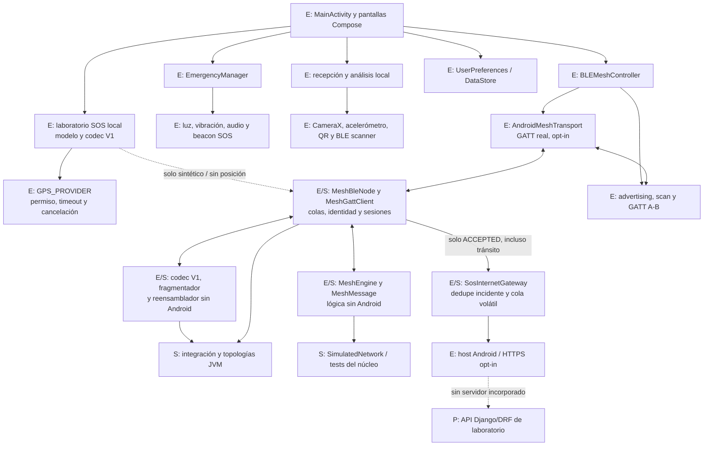
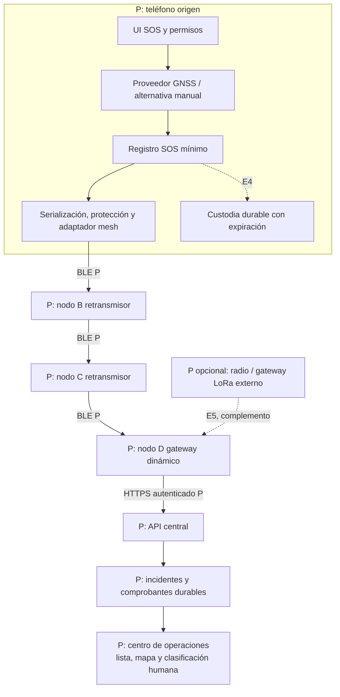
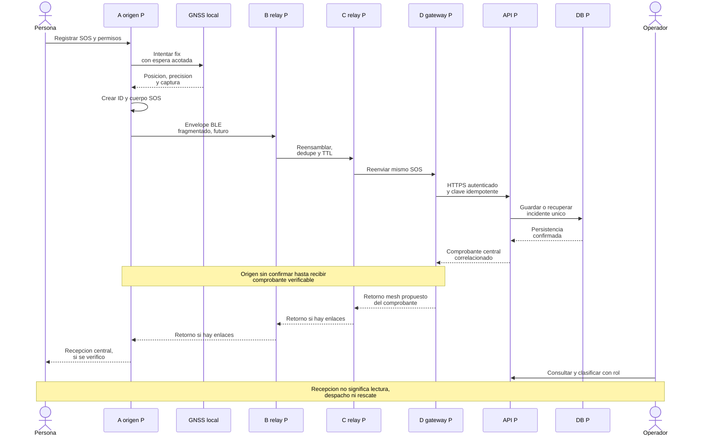
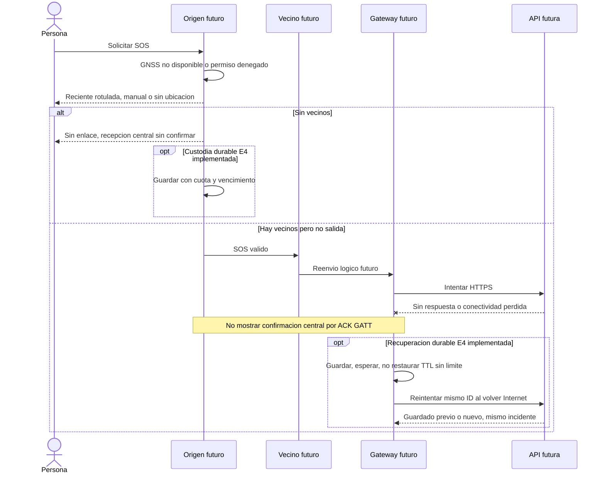
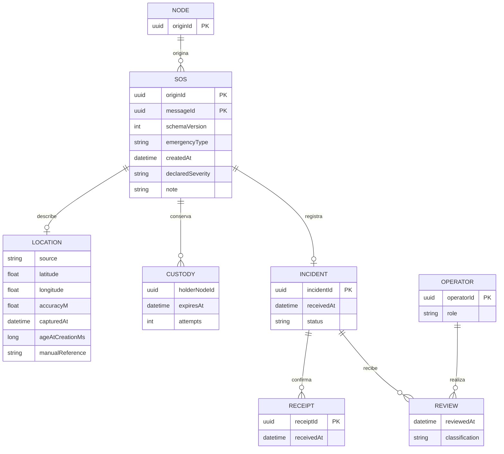
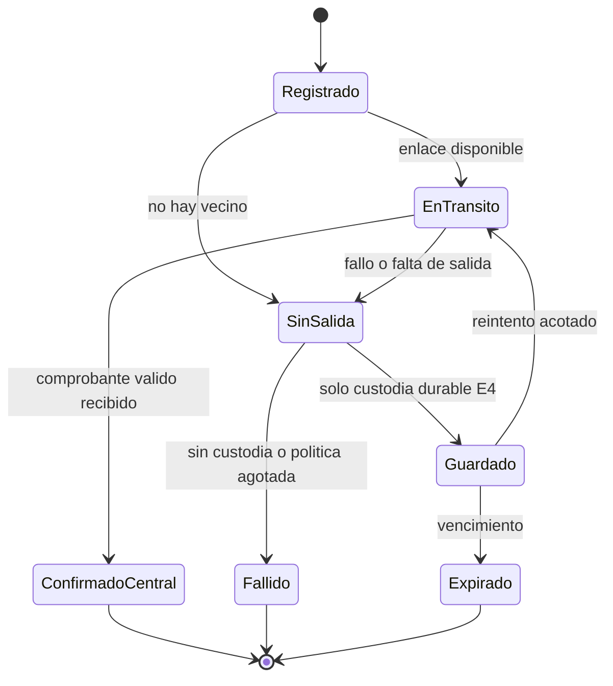

# 04 · Arquitectura actual y propuesta

**Vetrabyte / Nicolás Butterfield · [MIT](../LICENSE) · Borrador para revisión · Actualizado 21/10/2026**
[Índice](../README.md) · [Requerimientos](ERS-BeaconChat.md) · [Casos de uso](Casos-de-Uso-BeaconChat.md)

## Base verificable y fuentes locales

Base del checkout `7ca62ab2ac5fb6cd05cb4b96366dfdee5dfcfa9b` de `main`, limpia y coincidente con el remoto al comenzar #7A. Mesh Android, SOS offline y gateway HTTPS sintético están implementados en código; sus pruebas JVM no demuestran radio ni adquisición satelital físicas, y `LightMapScreen` no demuestra mapas geográficos.

| Fuente | Evidencia |
| --- | --- |
| [MainActivity](../app/src/main/java/com/nicobutter/beaconchat/MainActivity.kt), [MeshScreen](../app/src/main/java/com/nicobutter/beaconchat/ui/screens/MeshScreen.kt) | Activity/Composables, coordinación de controladores, permisos y ciclo de vida. MainActivity deriva de ComponentActivity; no se identifica como una clase ViewModel. |
| [BLEMeshController](../app/src/main/java/com/nicobutter/beaconchat/mesh/BLEMeshController.kt), [DirectBleProtocol](../app/src/main/java/com/nicobutter/beaconchat/mesh/DirectBleProtocol.kt) | Advertising/scanning y chat GATT directo intacto, 20 bytes; características mesh separadas, activas solo por participación explícita. |
| [MeshMessage](../app/src/main/java/com/nicobutter/beaconchat/mesh/core/MeshMessage.kt), [MeshEngine](../app/src/main/java/com/nicobutter/beaconchat/mesh/core/MeshEngine.kt) | Modelo lógico, TTL, dedupe y cola; sin tareas de red ni persistencia. |
| [Codec](../app/src/main/java/com/nicobutter/beaconchat/mesh/transport/MeshMessageCodec.kt), [fragmentación](../app/src/main/java/com/nicobutter/beaconchat/mesh/transport/MeshFragmentProtocol.kt), [reensamblador](../app/src/main/java/com/nicobutter/beaconchat/mesh/transport/MeshReassembler.kt) | Transporte binario V1 independiente de Android, tramas ≤20 bytes y recursos acotados; formato sin cambios. |
| [MeshBleNode](../app/src/main/java/com/nicobutter/beaconchat/mesh/ble/MeshBleNode.kt), [MeshGattClient](../app/src/main/java/com/nicobutter/beaconchat/mesh/ble/MeshGattClient.kt), [MeshLinkProtocol](../app/src/main/java/com/nicobutter/beaconchat/mesh/ble/MeshLinkProtocol.kt), [AndroidMeshTransport](../app/src/main/java/com/nicobutter/beaconchat/mesh/ble/AndroidMeshTransport.kt) | Adaptador con cola, identidad declarada por sesión y escrituras/recibos secuenciales; puente BluetoothGatt real compilado, política compartida con pruebas JVM. |
| [Pruebas de topologías](../app/src/test/java/com/nicobutter/beaconchat/mesh/core/MeshTopologyTest.kt), [red simulada](../app/src/test/java/com/nicobutter/beaconchat/mesh/core/SimulatedNetwork.kt) | Transporte simulado JVM; no uso del stack Bluetooth físico. |
| [Integración de transporte](../app/src/test/java/com/nicobutter/beaconchat/mesh/transport/MeshTransportIntegrationTest.kt) | Topologías JVM que serializan, fragmentan, reensamblan y decodifican en cada enlace antes de entregar al motor. |
| [Pruebas del adaptador](../app/src/test/java/com/nicobutter/beaconchat/mesh/ble/MeshBleAdapterTest.kt) | Mismo adaptador de producción, I/O GATT falso: cadena sin A↔C, diamante/anillo, fallos, cuotas y reconexión. No ejecuta el stack Android. |
| [SosIncident](../app/src/main/java/com/nicobutter/beaconchat/sos/SosIncident.kt), [SosCodec](../app/src/main/java/com/nicobutter/beaconchat/sos/SosCodec.kt), [SosMeshPolicy](../app/src/main/java/com/nicobutter/beaconchat/sos/SosMeshPolicy.kt) | Modelo/codec V1 y frontera de privacidad para ensayos mesh; UUID estable, ubicación opcional y máximo 433 bytes de contenido. |
| [GnssAcquisition](../app/src/main/java/com/nicobutter/beaconchat/sos/GnssAcquisition.kt), [AndroidGnssLocationSource](../app/src/main/java/com/nicobutter/beaconchat/sos/AndroidGnssLocationSource.kt), [SosLaboratoryDialog](../app/src/main/java/com/nicobutter/beaconchat/ui/screens/SosLaboratoryDialog.kt) | Política comprobable en JVM; GPS_PROVIDER asíncrono, cancelable, en primer plano y UI local. Sin ensayo satelital. |
| [EmergencyManager](../app/src/main/java/com/nicobutter/beaconchat/controller/EmergencyManager.kt), [BleEmitter](../app/src/main/java/com/nicobutter/beaconchat/emitter/BleEmitter.kt), [BleScanner](../app/src/main/java/com/nicobutter/beaconchat/scanner/BleScanner.kt) | Orquestación de señales y beacon SOS con un byte de tipo de emergencia. No transmite incidente ni coordenadas. |
| [Transmisor](../app/src/main/java/com/nicobutter/beaconchat/ui/screens/TransmitterScreen.kt), [receptor QR](../app/src/main/java/com/nicobutter/beaconchat/transceiver/QRScanner.kt), [detectores](../app/src/main/java/com/nicobutter/beaconchat/transceiver/LightDetector.kt) | Componentes ópticos/Morse, QR y otros canales locales, con validación física insuficiente. |
| [UserPreferences](../app/src/main/java/com/nicobutter/beaconchat/data/UserPreferences.kt) | Callsign en DataStore; no repositorio durable de SOS. |
| [Gradle de app](../app/build.gradle.kts), [manifiesto](../app/src/main/AndroidManifest.xml) | SDK 24/34 y BLE; ubicación FINE/COARSE en todas las versiones para GPS y hasta API 30 también para scan BLE. INTERNET y ACCESS_NETWORK_STATE para gateway opt-in; sin ubicación en segundo plano. |
| [Informe BLE](Validacion-BeaconChat.md), [informe del núcleo](Validacion-BeaconChat.md) | Resultados históricos reportados; no se reinterpretan como ensayos nuevos. |

El `LocationManager` del controlador BLE conserva su chequeo de proveedores para scan en Android anterior a 12. La captura SOS es un componente separado que solo usa GPS_PROVIDER y permiso propio. Hay gateway HTTPS de laboratorio desactivado por defecto; no hay API/backend real, mapas ni LoRa. GPS y MeshEngine↔BLE tienen código Android experimental compilado, sin validación física.

## Arquitectura AS-IS

La separación es descriptiva de componentes reales, no una declaración de Clean Architecture/MVVM completo. E indica código existente y S evidencia por simulación; ninguno acredita por sí solo radio probada. El chat y la mesh experimental guardan mensajes/colas en memoria. Los controladores se detienen según navegación/pausa; no hay servicio que sostenga esta mesh con pantalla bloqueada.

### Transporte directo y núcleo lógico

El paquete directo es UTF-8 estricto `CALLSIGN:MENSAJE`: **20 bytes totales**, callsign de hasta 8 bytes y un separador. Con callsign de 8 bytes quedan 11 para texto; caracteres y bytes no son equivalentes. Cabe en el MTU ATT mínimo de 23, con 3 bytes de overhead ATT. No negocia un canal de 512 bytes ni fragmenta.

El callback de escritura GATT solo confirma esa operación; no lectura, ACK de aplicación, recepción central ni rescate. La aceptación de `MeshTransport` solo confirma handoff local. El producto no implementa Bluetooth Mesh Profile.

| Propiedad de MeshEngine | Comportamiento actual S |
| --- | --- |
| Identidad | NodeId y MessageId UUID; key `(originId, messageId)`, nunca MAC/callsign |
| Modelo | Versión 1, destino opcional (`null` broadcast), texto y saltos restantes |
| TTL | Predeterminado máximo 16; decrementa al encolar cada copia de transmisión; en cero puede entregar localmente, no reenviar |
| Dedupe | 256 keys por defecto, 120 s; una key expirada puede volver a admitirse |
| Cola | 64 mensajes FIFO por defecto, 30 s de retención; llena rechaza el reenvío nuevo |
| Contenido | Hasta 1024 bytes UTF-8; no define tamaño de frame BLE |
| Despacho | Un intento por item; lo retira incluso con transporte no disponible o excepción; sin reintento automático |
| Host | Debe serializar llamadas y suministrar reloj monotónico local; sin threads/timers/background propios |

La deduplicación es temporal, no exactamente-una-vez durable. No hay store-and-forward/DTN persistente en ese núcleo. Sus límites no son parámetros de capacidad ya validados para una catástrofe.

### Transporte binario y adaptador Android experimental

El envelope V1 serializa UUID lógicos, destino opcional, TTL y contenido UTF-8 estricto: **37 + L bytes broadcast / 53 + L unicast**, hasta 1024 bytes de contenido. No modifica ningún campo en un round-trip; el motor conserva la responsabilidad de descontar TTL una sola vez por salto lógico. El perfil de transporte admite TTL 0..16.

Las tramas tienen hasta **20 bytes**, con 12 de cabecera y hasta 8 de payload. Incluyen marcador binario, versión, ID de transferencia local al enlace, índice, cantidad, longitud total y CRC32 del envelope. El máximo unicast requiere 135 tramas. El reensamblador separa sesiones de conexión de identidades permanentes, admite desorden/duplicados idénticos y limita transferencias activas, entradas cerradas, memoria y duración; únicamente una carga completa, con CRC correcto y validada por el codec puede pasar al motor. CRC32 comprueba corrupción accidental del conjunto: **no equivale a autenticación ni cifrado**.

`MeshGattContract` registra dos características READ/WRITE propias en C4A7: datos/recibos `…b501` e identidad/capacidades `…b502`, rechazadas mientras la participación esté apagada. El advertising y la característica legacy permanecen con su formato anterior. Los candidatos detectados por scan se sondean mediante descubrimiento GATT y hello versionado de 20 bytes. Su NodeId declarado se asocia a la sesión, se verifica antes de cada envío y se usa como `previousHop`; MAC y callsign no identifican permanentemente al nodo. El UUID local se persiste en preferencias privadas mediante IO antes de permitir participar. Ese intercambio no autentica la identidad.

`MeshBleNode` es dueño del motor y del reensamblador. El motor autoriza copias, decrementa TTL una vez y pasa el fanout a una cola local atómica y acotada. `MeshGattClient` conecta con un solo vecino por vez, intercambia identidades y alterna WRITE de trama / READ del recibo correlacionado por transferencia, índice y CRC. Solo después avanza. `AndroidMeshTransport` implementa esas operaciones con BluetoothGatt asíncrono y callbacks serializados en main; no bloquea esperando radio o disco. El servidor reconstruye, verifica CRC y codec, entrega al motor y encola las copias autorizadas hacia otros NodeId. Chat directo y mesh arbitran el cliente saliente.

Hay hasta 16 vecinos, 8 trabajos incluyendo el activo, 8 sesiones entrantes y 32 eventos de historial; los límites del reensamblador se mantienen. Existen timeouts por operación, transferencia, cola y conexión; desconexión, cancelación y pausa liberan sesiones y descartan cargas parciales. Los callbacks de conexiones anteriores se ignoran, y un recibo antiguo no permite saltar de trama. No hay recuperación automática de mensajes perdidos ni custodia persistente.

El diálogo “Mesh experimental” de `MeshScreen` permite activar/desactivar participación, originar pruebas con destino opcional y TTL, copiar NodeId y consultar vecinos/actividad. La participación mantiene scan/publicidad en primer plano y se desactiva al pausar/salir. La UI distingue origen local, cola local, escrito en enlace y recibido localmente. **Handoff y recibo de trama no confirman el destino final.** No hay ACK extremo a extremo, autenticación ni cifrado.

La base de **225 tests JVM** se conserva; [Validación](Validacion-BeaconChat.md) registra **235 aprobados**, con 10 nuevos de sesiones/temporización/diagnóstico en #7A. Android/GATT/GPS/HTTPS están implementados y compilados; BLE, satélites, conectividad y TLS reales siguen pendientes. El gateway está integrado, sin servidor ni mapas.

### Estabilización BLE · implementación #7A

`MeshIncomingSessions` vincula cada sesión lógica a una conexión entrante registrada por el callback CONNECTED. Direcciones/callbacks duplicados conservan la misma encarnación. Una sesión vencida queda en cierre y ocupa su cuota hasta el DISCONNECTED real; solicitudes posteriores no pueden recrearla sobre el mismo enlace. El servidor mantiene un máximo de 8 conexiones registradas y cada reconexión obtiene otro token. Detener el servidor limpia el registro. El cliente comprueba deadlines también al procesar callbacks; el servidor los comprueba al procesar solicitudes y el tráfico rechazado no renueva inactividad.

`MeshBleTiming` conserva 5 s por operación y 30 s de cola/vecinos, y fija transferencia `max(14000, tramas × 300 + 1000)` ms: 14–41,5 s. El presupuesto experimental de 150 ms por WRITE y READ permite 135 tramas máximas sin abandonar las cuotas de recursos. El adaptador inyecta reensamblado absoluto de 42,5 s; trabajo saliente 61,5 s y sesión entrante 62,5 s, con inactividad de 20 s. IDs de 16 bits no vuelven a 0 durante esa retención. No cambian memoria máxima, tamaños, cuotas de transferencias, TTL/dedupe ni wire V1. El reensamblador genérico conserva su default de 15 s para otros hosts. Peers con APK previa pueden vencer a los 14/15 s: el hello V1 no negocia ventanas; las pruebas lentas requieren la misma APK.

`MeshDiagnostics` transmite únicamente metadatos tipados a un observador opcional; `MeshDebugLog` escribe tag `BeaconMesh` solo en debug. Mide connect/discovery/identidades/WRITE/READ, transferencia y trabajo completos; registra radio, identidad declarada, sesiones, fragmentos, UUID/TTL de recepción/reenvío y fallos. No recibe payload, coordenadas, notas, credenciales ni mensajes de excepción. Su fallo no interrumpe transporte. No modifica el historial experimental ni convierte LINK_WRITTEN en confirmación del destino.

Con GATT falso a 100 ms por operación: HOLA 1,6 s, SOS típico 5,2 s, máximo SOS 12,2 s y 1024 bytes 27 s de transferencia. El máximo también completa a 150 ms/operación en 40,5 s; a 200 ms vence sin entrega parcial. Estos tiempos son simulados. ADB no detectó teléfonos: A↔B/A→B→C físicos **NO EJECUTADOS**. [Validación](Validacion-BeaconChat.md) contiene cargas públicas verificadas por JVM, herramientas por serial explícito, mediciones y procedimiento con aislamiento comprobable. No se añade backend, mapas, protocolos alternativos ni transmisión GNSS real.

### SOS offline y separación de datos reales/sintéticos

`SosIncident` es un cuerpo inmutable con UUID, versión, tipo, gravedad declarada, creación local, nota opcional y `SosPosition?`. La ubicación ausente es null; (0,0) solo puede ser una coordenada explícita válida. Fuente GNSS/sintética/mock, precisión estimada opcional, edad no negativa y validez deben ser coherentes. Nota ≤256 bytes UTF-8 estrictos; el codec usa prefijo `BCSOS:` más base64url canónico sin padding de un registro binario big endian, de hasta **433 bytes ASCII**. No modifica MeshMessageCodec ni fragmentación. [Contrato exacto](Validacion-BeaconChat.md).

`AndroidGnssLocationSource` registra GPS_PROVIDER con LocationManager y entrega callbacks en main, sin esperar sincrónicamente un fix. No usa proveedor de red ni geocodificador. Pide permiso preciso en primer plano, también API 31+, ofreciendo degradación sin posición ante acceso aproximado/denegado. Timeout configurable 1..120 s (30 s predeterminado), cancelación y baja de listeners al pausar/cerrar/destruir. `GnssAcquisition` mantiene un único candidato y valida tokens, vencimiento y edad mediante tiempo monotónico local. El fix cacheado nunca se marca como nuevo; CURRENT exige callback de ≤30 s y más de 5 min se rotula STALE. La edad se recalcula al crear el SOS; su cuerpo fija esa instantánea y la UI la identifica como tal. GPS_PROVIDER no demuestra por sí solo observación satelital: mocks se rotulan aparte.

La UI mantiene el SOS real en memoria local no guardada y lo descarta al pausar/cerrar; no lo añade al historial mesh ni lo persiste. Una acción separada prepara un incidente de laboratorio con nuevo UUID, nota fija y posición sintética constante `12.3456,-45.6789`, o sin coordenadas. No copia ubicación ni nota local. `SosMeshGateway` conserva UUID/cuerpo del SOS durante reintentos; cada intento usa un nuevo messageId mesh para no confundirlo con un duplicado del mismo intento. Esto no implementa deduplicación central de incidentes.

`SosMeshPolicy` se aplica tanto en origen como después de reensamblar/decodificar y antes de MeshEngine.receive. Solo acepta SOS marcados laboratorio con posición fija o ausente; bloquea GNSS/mock real, coordenadas arbitrarias con etiqueta sintética y prefijos SOS malformados sin guardar el contenido en eventos. Chat normal y protocolo directo permanecen. Es una barrera de aplicación para el espacio `BCSOS:`, no autenticación, cifrado ni un detector de coordenadas escritas en texto arbitrario. Un peer antiguo no conoce esta política; no se envían datos reales para comprobarlo.

“Laboratorio SOS offline” permite seleccionar tipo/gravedad, solicitar GPS, crear local/sin posición y emitir/reintentar solo el ensayo. Recibir el mensaje interpreta el SOS y muestra su UUID, fuente y estado local. Origen local, admisión en cola y escrito en enlace siguen separados de recepción local y de **destino final sin confirmar**. Captura satelital, UI/permisos sobre Android y radio física permanecen pendientes; no es rescate operativo.

### Gateway HTTPS de laboratorio · implementación #6

`SosInternetGateway` es distinto de `SosMeshGateway`: el segundo origina un SOS hacia mesh; el primero consume únicamente mensajes entrantes ya aceptados por MeshEngine. `MeshBleNode.acceptedInbound` se invoca después de la política SOS y de `receive == ACCEPTED`, para cualquier destino lógico. No consulta eventos UI ni `LOCAL_RECEIVED` y no altera TTL/relay. Mensajes rechazados/duplicados y origen local no generan entregas por este punto.

Dominio y cola son Kotlin puro. `LabApiContract` define URL HTTPS versionada, DTO con campos permitidos, transporte HTTP inyectable y cliente con validador de comprobante. La huella del SOS completo detecta conflictos con el mismo UUID, incluso de nota; solo DTO/huella/estado permanecen en cola. HTTP excluye notas, identidades y GNSS reales. Se reaplica SosMeshPolicy: posición fija sintética o ausencia, sin cambiar sus bloqueos.

Cuotas por gateway: 16 pendientes/64 incidentes/32 eventos, cola 5 min y dedupe 10 min desde recepción monotónica, un envío activo cada ≥5 s, hasta 3 intentos con espera 5/10 s, deadline lógico 20 s. Cola llena rechaza sin expulsar y guarda tombstone si hay memoria; memoria llena rechaza nuevos UUID. Todo es volátil; reinicio/retención vencida permite otra admisión y exige idempotencia durable futura en API. No hay custodia ni dedupe compartido entre gateways.

`AndroidSosInternetGateway` serializa dominio en main; usa IO para HTTPS y disconnect. Comprueba INTERNET + VALIDATED y ausencia de portal cautivo; no garantiza acceso a la API. Un worker HTTP y como máximo uno de cancelación, conservados hasta finalizar aunque venza el deadline lógico: DNS/escritura pueden demorar según plataforma. Tokens de intento/activación rechazan resultados tardíos y evitan reutilizar consentimiento; cancelación captura la conexión anterior. Pausa/salida/mesh apagado revocan salida y descartan pendientes. Un POST ya iniciado puede quedar UNKNOWN.

`HttpsLabHttpTransport` usa HttpsURLConnection con trust store y verificación hostname normales; no acepta HTTP ni redirecciones. No hay endpoints/credenciales incorporados ni autenticación implementada. INTERNET/ACCESS_NETWORK_STATE se usan para operaciones efectivas. `MeshScreen` ofrece URL y activación explícita, estados y comprobantes sin modificar laboratorio GNSS/chat. [Contrato JSON, estados, evidencia y pendientes](Validacion-BeaconChat.md).

LAB_CONFIRMED exige 200/201, UUID esperado, comprobante `lab_…` válido y persistencia de laboratorio explícita; no acredita atención/rescate ni verificación independiente del guardado. Cola/GATT/TLS no confirman. No se devuelve el comprobante al origen BLE. La API falsa modela persistencia idempotente solo en memoria; Django/DRF, permisos de gateway, transacción e idempotencia real siguen pendientes. Las secciones TO-BE siguientes describen el sistema integral futuro con datos reales protegidos, no el alcance sintético actual.

## Arquitectura TO-BE, íntegramente propuesta

Cada teléfono compatible podría ser origen/retransmisor/gateway según conectividad y política. El gateway exige acceso real a la API, no solo señal Wi-Fi. El centro inicial será de laboratorio, sin enlace a servicios oficiales. El mapa es una vista del centro; obtener coordenadas GNSS no requiere tener un mapa en la app.

### Integración, seguridad y presupuesto de bytes

Se conserva el chat directo; transporte V1, adaptador Android y SOS mínimo ya están implementados arriba. El sistema SOS protegido hasta un centro sigue propuesto: agregará protección/datos de dominio y no se enviará como texto truncado en `CALLSIGN:MENSAJE`. Hoy solo se habilitan ensayos sintéticos o sin ubicación en mesh.

El serializer V1 usa **53 + L bytes** unicast: con `HOLA` son 57, aun sin ubicación ni criptografía. Su fragmentador genera 8 tramas para ese mensaje. El presupuesto SOS futuro deberá sumar datos de dominio y protección, y revisar el límite actual de 1024 bytes de contenido. El reensamblador existente incorpora índices, cantidad, longitud total, CRC32, timeout y cuotas por sesión/globales; la pérdida de un fragmento impide entregar al núcleo, pero no desencadena recuperación automática.

El adaptador actual aplica backpressure mediante cola acotada y coordina llamadas serializadas al motor; conserva el TTL ya descontado por este. Ningún fragmento descuenta TTL. Aceptar el puerto síncrono solo admite la cola local. La UI experimental está conectada y rotula estados sin promesa de destino final; faltan ensayos de radio, peers legados y fallos parciales sobre teléfonos antes de atribuir funcionamiento físico.

Se propone un cuerpo SOS inmutable protegido hasta el centro, con metadatos mínimos de tránsito separados. El TTL mutable requiere reglas y controles antiabuso propios: proteger el cuerpo no impide que un nodo malicioso intente restaurar TTL. Identidad lógica no equivale a autenticación. Provisión/revocación de claves, cifrado offline hacia el centro y autenticación de emisores no están resueltos ni se elige aquí un protocolo criptográfico ad hoc.

### Secuencia normal propuesta

El retorno de comprobantes es una decisión de protocolo futura y puede fallar por movilidad. No está resuelto por el GATT directo ni por el núcleo actual. El centro puede recibir aunque A no llegue a enterarse.

### Secuencia de fallos y recuperación propuesta

## Modelo conceptual de datos propuesto

El modelo central completo siguiente sigue propuesto, sin esquema SQL ni API. `SosIncident` implementa ahora el subconjunto local UUID/tipo/gravedad/creación/nota/posición y calidad; no implementa incidentes centrales, comprobantes, roles, ubicación manual ni custodia durable. Sus campos/contrato V1 se describen arriba y en Validación, separados de esta propuesta ampliada.

| Entidad / campo | Semántica y validación propuesta |
| --- | --- |
| SOS: `originId`, `messageId` | Identidad estable compuesta, usada en dedupe/transporte y como clave idempotente central; un reintento no crea otro ID |
| SOS: `schemaVersion`, `emergencyType` | Versión y catálogo explícito; no asumir que ordinal interno de enum sea contrato público estable |
| SOS: `createdAt` | Momento declarado de creación; marcar incertidumbre del reloj civil, no prueba de autenticidad |
| SOS: `declaredSeverity`, `note` | Gravedad declarada y nota breve opcional, con longitud UTF-8 acotada antes de ensayar; sin nombres/documentos obligatorios |
| Location: `source`, coordenadas opcionales | `gnss`, `lastKnown`, `manual` o `unavailable`; latitud −90..90 y longitud −180..180 cuando existan; no usar valores por defecto como posición |
| Location: `accuracyM`, `capturedAt`, `ageAtCreationMs` | Precisión estimada si la fuente la provee, momento de captura y edad calculada localmente; dato desconocido explícito. Posición manual no recibe precisión GNSS ficticia |
| Location: `manualReference` | Descripción opcional de lugar, sin geocodificación inventada; puede existir sin coordenadas |
| Tránsito: `hopsRemaining`, versión y fragmentos | Metadatos por enlace, separados del cuerpo inmutable. Número de saltos no es tiempo de vida |
| Custodia E4: vencimiento, intentos, próxima ejecución | Persistencia local protegida, cuotas y política durable; no son los 30 s de cola actuales |
| Incident: `incidentId`, `receivedAt`, estado | ID interno central, referencia al SOS único, hora del servidor y ciclo de atención humana separado del transporte |
| Receipt: clave SOS, `receivedAt`, comprobante | Respuesta verificable de persistencia; no es ACK GATT ni orden de rescate |
| Review: operador, tiempo, clasificación | Cambio autorizado/auditable; gravedad revisada distinguible de la declarada |

SOS→INCIDENT es 0..1 mientras todavía no hubo llegada central; la unicidad es por clave compuesta SOS, con transacción persistente. El gráfico no expresa nulabilidad de atributos: coordenadas/calidad pueden faltar. En la carga se incluirá el estado explícito `unavailable` cuando corresponda. Nuevos datos de posición o cancelación requerirán eventos/revisiones correlacionadas diseñadas por separado; no se muta silenciosamente un SOS deduplicado.

La edad de ubicación aumenta durante el tránsito. La API debe conservar edad al crear, captura declarada y recepción de servidor, e indicar incertidumbre temporal; relojes de teléfonos distintos pueden discrepar. El reloj monotónico del núcleo es local, no sincroniza los tiempos civiles del SOS.

## Estados y decisiones abiertas

Es la vista de conocimiento de un nodo, no el estado global del rescate. El centro puede tener el incidente aunque el emisor permanezca sin confirmar. Los estados centrales de clasificación/asignación/atención son otro ciclo futuro, con responsables y reglas propias.

| Decisión de diseño | Propuesta y consecuencia | Pendiente antes de código/operación |
| --- | --- | --- |
| AD-01 · BLE como cadena mínima | Reutilizar componentes, separar chat legado y mesh; no requerir LoRa | Codec/fragmentos y adaptador GATT experimental implementados; faltan ensayos físicos y diseño de fiabilidad/identidad segura |
| AD-02 · Ubicación honesta | GNSS local, conocido/antiguo/ausente; manual aún propuesto | Código: 30 s fresco, 5 min conocido, timeout 1..120 s; falta ensayo satelital/precisión y envío protegido de datos reales |
| AD-03 · Confirmar solo persistencia | Comprobante autenticable y dedupe central | Contrato API, errores, retorno mesh y conflicto de mismo ID |
| AD-04 · Custodia separada del núcleo | No convertir FIFO temporal en promesa DTN | Retención, cuotas, recuperación, TTL e idempotencia tras reinicio |
| AD-05 · Datos mínimos protegidos | Relays sin acceso innecesario a coordenadas/notas | Amenazas, claves offline, revocación, consentimiento y acceso |
| AD-06 · Centro de laboratorio primero | Clasificación humana, datos sintéticos; mapas solo si hay datos válidos | Responsable de operación, licencias cartográficas, integración oficial futura |

Las decisiones de centro/seguridad integral siguen propuestas, no ADR históricos aprobados. El transporte, adaptador lógico, SOS/política GNSS y gateway sintético se prueban en JVM. GATT/GPS/HTTPS Android están compilados, sin resultado físico todavía. FINE/COARSE cubren GPS reciente; INTERNET y ACCESS_NETWORK_STATE cubren el gateway opt-in. No se añaden dependencias, ubicación de fondo ni servicios Android.

---

## Referencia de arquitectura previa

El inventario previo de componentes se mantiene [en el historial de Git](https://github.com/NicoButter/beaconchat/blob/c364293f42823d863976a5608aede8d3da7a50d3/docs/ARCHITECTURE.md). La arquitectura vigente aquí reemplaza aquella interpretación histórica; no se considera validación del sistema multisalto.
