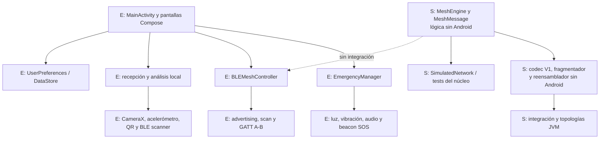
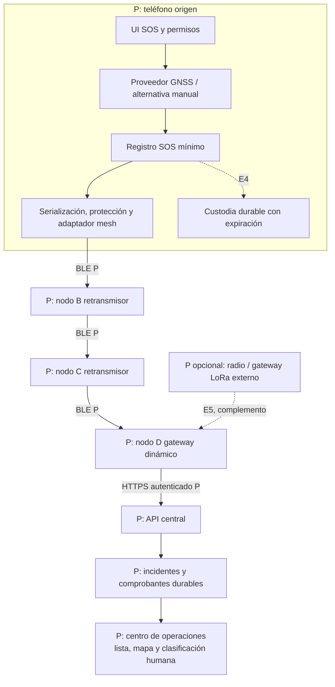
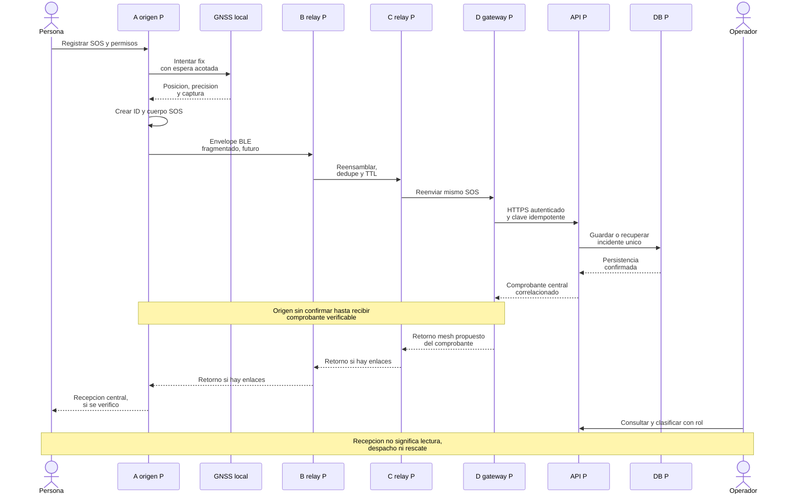
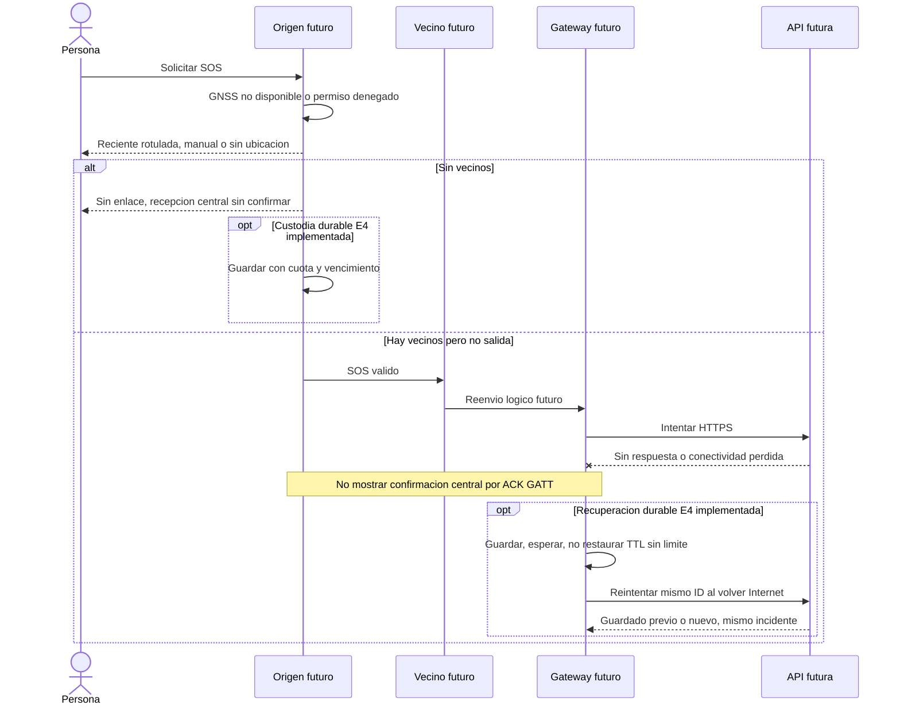
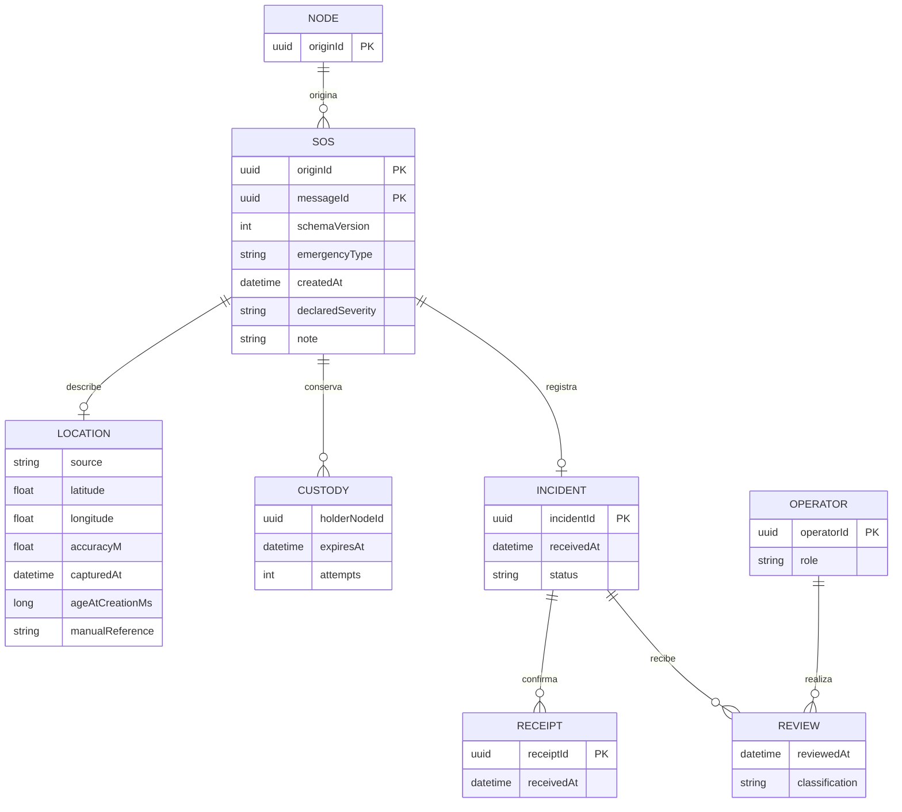
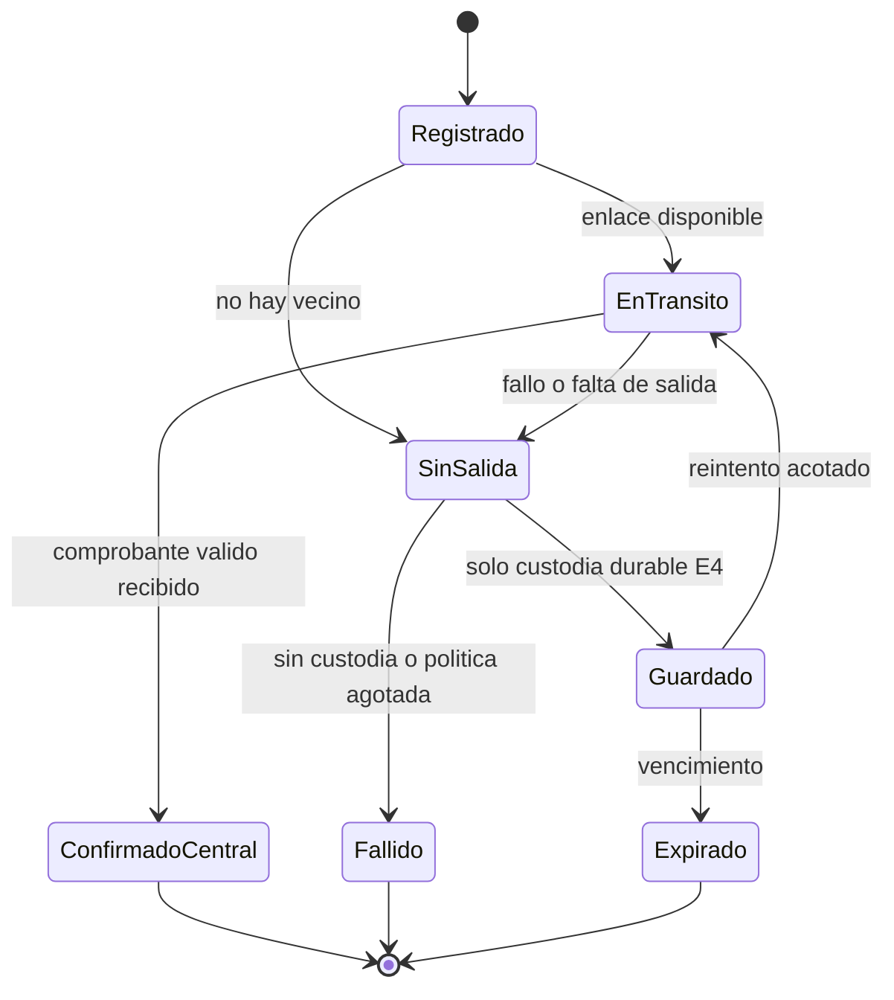

# 04 · Arquitectura actual y propuesta

**Vetrabyte / Nicolás Butterfield · [MIT](../LICENSE) · Borrador para revisión · Actualizado 18/10/2026**
[Índice](../README.md) · [Requerimientos](ERS-BeaconChat.md) · [Casos de uso](Casos-de-Uso-BeaconChat.md)

## Base verificable y fuentes locales

Base del checkout `604d9898b6fa132a8b35ca81ef60752de4a0305b` de `main`, con transporte binario agregado el 18/10/2026. Las rutas siguientes sustentan el estado; el nombre `BLEMeshController` o `LightMapScreen` no demuestra mesh multisalto ni mapas geográficos.

| Fuente | Evidencia |
| --- | --- |
| [MainActivity](../app/src/main/java/com/nicobutter/beaconchat/MainActivity.kt), [MeshScreen](../app/src/main/java/com/nicobutter/beaconchat/ui/screens/MeshScreen.kt) | Activity/Composables, coordinación de controladores, permisos y ciclo de vida. MainActivity deriva de ComponentActivity; no se identifica como una clase ViewModel. |
| [BLEMeshController](../app/src/main/java/com/nicobutter/beaconchat/mesh/BLEMeshController.kt), [DirectBleProtocol](../app/src/main/java/com/nicobutter/beaconchat/mesh/DirectBleProtocol.kt) | Advertising/scanning y cliente/servidor GATT directo; máximo 20 bytes totales. |
| [MeshMessage](../app/src/main/java/com/nicobutter/beaconchat/mesh/core/MeshMessage.kt), [MeshEngine](../app/src/main/java/com/nicobutter/beaconchat/mesh/core/MeshEngine.kt) | Modelo lógico, TTL, dedupe y cola; sin tareas de red ni persistencia. |
| [Codec](../app/src/main/java/com/nicobutter/beaconchat/mesh/transport/MeshMessageCodec.kt), [fragmentación](../app/src/main/java/com/nicobutter/beaconchat/mesh/transport/MeshFragmentProtocol.kt), [reensamblador](../app/src/main/java/com/nicobutter/beaconchat/mesh/transport/MeshReassembler.kt) | Transporte binario V1 independiente de Android, tramas ≤20 bytes y recursos acotados; contrato GATT reservado sin activar. |
| [Pruebas de topologías](../app/src/test/java/com/nicobutter/beaconchat/mesh/core/MeshTopologyTest.kt), [red simulada](../app/src/test/java/com/nicobutter/beaconchat/mesh/core/SimulatedNetwork.kt) | Transporte simulado JVM; no uso del stack Bluetooth físico. |
| [Integración de transporte](../app/src/test/java/com/nicobutter/beaconchat/mesh/transport/MeshTransportIntegrationTest.kt) | Topologías JVM que serializan, fragmentan, reensamblan y decodifican en cada enlace antes de entregar al motor. |
| [EmergencyManager](../app/src/main/java/com/nicobutter/beaconchat/controller/EmergencyManager.kt), [BleEmitter](../app/src/main/java/com/nicobutter/beaconchat/emitter/BleEmitter.kt), [BleScanner](../app/src/main/java/com/nicobutter/beaconchat/scanner/BleScanner.kt) | Orquestación de señales y beacon SOS con un byte de tipo de emergencia. No transmite incidente ni coordenadas. |
| [Transmisor](../app/src/main/java/com/nicobutter/beaconchat/ui/screens/TransmitterScreen.kt), [receptor QR](../app/src/main/java/com/nicobutter/beaconchat/transceiver/QRScanner.kt), [detectores](../app/src/main/java/com/nicobutter/beaconchat/transceiver/LightDetector.kt) | Componentes ópticos/Morse, QR y otros canales locales, con validación física insuficiente. |
| [UserPreferences](../app/src/main/java/com/nicobutter/beaconchat/data/UserPreferences.kt) | Callsign en DataStore; no repositorio durable de SOS. |
| [Gradle de app](../app/build.gradle.kts), [manifiesto](../app/src/main/AndroidManifest.xml) | SDK 24/34, BLE y permisos. Ubicación hasta API 30 para scan BLE; sin permiso INTERNET ni servicio de incidentes. |
| [Informe BLE](Validacion-BeaconChat.md), [informe del núcleo](Validacion-BeaconChat.md) | Resultados históricos reportados; no se reinterpretan como ensayos nuevos. |

El `LocationManager` del controlador BLE solo comprueba proveedores habilitados para escaneo en Android anterior a 12. Esa comprobación no obtiene ni georreferencia un incidente. El análisis de fuentes no encontró componentes de GNSS para SOS, API/backend, mapas, LoRa o integración activa entre MeshEngine y BLE.

## Arquitectura AS-IS

La separación es descriptiva de componentes reales, no una declaración de Clean Architecture/MVVM completo. El chat guarda peers/mensajes en memoria. Los controladores se detienen según navegación/pausa; no existe un servicio probado que sostenga la futura mesh con pantalla bloqueada.

### Transporte directo y núcleo lógico

El paquete directo es UTF-8 estricto `CALLSIGN:MENSAJE`: **20 bytes totales**, callsign de hasta 8 bytes y un separador. Con callsign de 8 bytes quedan 11 para texto; caracteres y bytes no son equivalentes. Cabe en el MTU ATT mínimo de 23, con 3 bytes de overhead ATT. No negocia un canal de 512 bytes ni fragmenta.

El callback de escritura GATT solo confirma esa operación; no lectura, ACK de aplicación, recepción central ni rescate. La aceptación de `MeshTransport` solo confirma handoff local. El producto no implementa Bluetooth Mesh Profile.

| Propiedad de MeshEngine | Comportamiento actual S |
| --- | --- |
| Identidad | NodeId y MessageId UUID; key `(originId, messageId)`, nunca MAC/callsign |
| Modelo | Versión 1, destino opcional (`null` broadcast), texto y saltos restantes |
| TTL | Predeterminado máximo 16; decrementa al encolar cada copia de transmisión; en cero puede entregar localmente, no reenviar |
| Dedupe | 256 keys por defecto, 120 s; una key expirada puede volver a admitirse |
| Cola | 64 mensajes FIFO por defecto, 30 s de retención; llena rechaza el reenvío nuevo |
| Contenido | Hasta 1024 bytes UTF-8; no define tamaño de frame BLE |
| Despacho | Un intento por item; lo retira incluso con transporte no disponible o excepción; sin reintento automático |
| Host | Debe serializar llamadas y suministrar reloj monotónico local; sin threads/timers/background propios |

La deduplicación es temporal, no exactamente-una-vez durable. No hay store-and-forward/DTN persistente en ese núcleo. Sus límites no son parámetros de capacidad ya validados para una catástrofe.

### Transporte binario implementado, todavía sin radio

El envelope V1 serializa UUID lógicos, destino opcional, TTL y contenido UTF-8 estricto: **37 + L bytes broadcast / 53 + L unicast**, hasta 1024 bytes de contenido. No modifica ningún campo en un round-trip; el motor conserva la responsabilidad de descontar TTL una sola vez por salto lógico. El perfil de transporte admite TTL 0..16.

Las tramas tienen hasta **20 bytes**, con 12 de cabecera y hasta 8 de payload. Incluyen marcador binario, versión, ID de transferencia local al enlace, índice, cantidad, longitud total y CRC32 del envelope. El máximo unicast requiere 135 tramas. El reensamblador separa sesiones de conexión de identidades permanentes, admite desorden/duplicados idénticos y limita transferencias activas, entradas cerradas, memoria y duración; únicamente una carga completa, con CRC correcto y validada por el codec puede pasar al motor. CRC32 comprueba corrupción accidental del conjunto: **no equivale a autenticación ni cifrado**.

Se reserva una característica mesh propia mediante `MeshGattContract`; no se registra ni anuncia. El chat directo sigue usando exclusivamente su protocolo UTF-8 anterior. No se identifican nodos por MAC/callsign ni se interpreta texto legacy como fragmentos. Un futuro adaptador deberá administrar sesiones e IDs de transferencia, descubrir explícitamente el canal, acotar sus colas y proveer la identidad lógica del vecino.

El [contrato completo, cuotas y evidencia](Validacion-BeaconChat.md) registra **110 tests JVM aprobados**, incluidos 62 nuevos de transporte/integración. No hay adaptador GATT activo, fiabilidad mediante ACK/reintentos ni prueba física del transporte; A↔B continúa pendiente. Los componentes lógicos y el transporte no se invocan desde `BLEMeshController` ni `MeshScreen`.

## Arquitectura TO-BE, íntegramente propuesta

Cada teléfono compatible podría ser origen/retransmisor/gateway según conectividad y política. El gateway exige acceso real a la API, no solo señal Wi-Fi. El centro inicial será de laboratorio, sin enlace a servicios oficiales. El mapa es una vista del centro; obtener coordenadas GNSS no requiere tener un mapa en la app.

### Integración, seguridad y presupuesto de bytes

Se conserva el chat directo; formato, tamaños y pruebas del transporte lógico V1 ya están implementados arriba. La integración GATT deberá descubrir explícitamente una característica mesh separada. El mensaje SOS rico sigue siendo una propuesta: excederá el presupuesto directo con UUID, tiempos, posición y protección; no se enviará como texto truncado en `CALLSIGN:MENSAJE`.

El serializer V1 usa **53 + L bytes** unicast: con `HOLA` son 57, aun sin ubicación ni criptografía. Su fragmentador genera 8 tramas para ese mensaje. El presupuesto SOS futuro deberá sumar datos de dominio y protección, y revisar el límite actual de 1024 bytes de contenido. El reensamblador existente incorpora índices, cantidad, longitud total, CRC32, timeout y cuotas por sesión/globales; la pérdida de un fragmento impide entregar al núcleo, pero no desencadena recuperación automática.

El adaptador asíncrono necesitará backpressure y coordinación serializada con MeshEngine; conservará el TTL del mensaje despachado por el motor, que ya lo descuenta una vez por salto lógico. Ningún fragmento descuenta TTL. No podrá asumir que su puerto síncrono equivale a recepción por Bluetooth. Se evaluarán pruebas con peers legados y fallos parciales antes de conectar la UI.

Se propone un cuerpo SOS inmutable protegido hasta el centro, con metadatos mínimos de tránsito separados. El TTL mutable requiere reglas y controles antiabuso propios: proteger el cuerpo no impide que un nodo malicioso intente restaurar TTL. Identidad lógica no equivale a autenticación. Provisión/revocación de claves, cifrado offline hacia el centro y autenticación de emisores no están resueltos ni se elige aquí un protocolo criptográfico ad hoc.

### Secuencia normal propuesta

El retorno de comprobantes es una decisión de protocolo futura y puede fallar por movilidad. No está resuelto por el GATT directo ni por el núcleo actual. El centro puede recibir aunque A no llegue a enterarse.

### Secuencia de fallos y recuperación propuesta

## Modelo conceptual de datos propuesto

Este modelo no existe como clases de incidentes, esquema SQL ni API en el repositorio. Es una base de discusión; el formato lógico actual solo tiene los campos de MeshMessage descritos arriba.

| Entidad / campo | Semántica y validación propuesta |
| --- | --- |
| SOS: `originId`, `messageId` | Identidad estable compuesta, usada en dedupe/transporte y como clave idempotente central; un reintento no crea otro ID |
| SOS: `schemaVersion`, `emergencyType` | Versión y catálogo explícito; no asumir que ordinal interno de enum sea contrato público estable |
| SOS: `createdAt` | Momento declarado de creación; marcar incertidumbre del reloj civil, no prueba de autenticidad |
| SOS: `declaredSeverity`, `note` | Gravedad declarada y nota breve opcional, con longitud UTF-8 acotada antes de ensayar; sin nombres/documentos obligatorios |
| Location: `source`, coordenadas opcionales | `gnss`, `lastKnown`, `manual` o `unavailable`; latitud −90..90 y longitud −180..180 cuando existan; no usar valores por defecto como posición |
| Location: `accuracyM`, `capturedAt`, `ageAtCreationMs` | Precisión estimada si la fuente la provee, momento de captura y edad calculada localmente; dato desconocido explícito. Posición manual no recibe precisión GNSS ficticia |
| Location: `manualReference` | Descripción opcional de lugar, sin geocodificación inventada; puede existir sin coordenadas |
| Tránsito: `hopsRemaining`, versión y fragmentos | Metadatos por enlace, separados del cuerpo inmutable. Número de saltos no es tiempo de vida |
| Custodia E4: vencimiento, intentos, próxima ejecución | Persistencia local protegida, cuotas y política durable; no son los 30 s de cola actuales |
| Incident: `incidentId`, `receivedAt`, estado | ID interno central, referencia al SOS único, hora del servidor y ciclo de atención humana separado del transporte |
| Receipt: clave SOS, `receivedAt`, comprobante | Respuesta verificable de persistencia; no es ACK GATT ni orden de rescate |
| Review: operador, tiempo, clasificación | Cambio autorizado/auditable; gravedad revisada distinguible de la declarada |

SOS→INCIDENT es 0..1 mientras todavía no hubo llegada central; la unicidad es por clave compuesta SOS, con transacción persistente. El gráfico no expresa nulabilidad de atributos: coordenadas/calidad pueden faltar. En la carga se incluirá el estado explícito `unavailable` cuando corresponda. Nuevos datos de posición o cancelación requerirán eventos/revisiones correlacionadas diseñadas por separado; no se muta silenciosamente un SOS deduplicado.

La edad de ubicación aumenta durante el tránsito. La API debe conservar edad al crear, captura declarada y recepción de servidor, e indicar incertidumbre temporal; relojes de teléfonos distintos pueden discrepar. El reloj monotónico del núcleo es local, no sincroniza los tiempos civiles del SOS.

## Estados y decisiones abiertas

Es la vista de conocimiento de un nodo, no el estado global del rescate. El centro puede tener el incidente aunque el emisor permanezca sin confirmar. Los estados centrales de clasificación/asignación/atención son otro ciclo futuro, con responsables y reglas propias.

| Decisión de diseño | Propuesta y consecuencia | Pendiente antes de código/operación |
| --- | --- | --- |
| AD-01 · BLE como cadena mínima | Reutilizar componentes, separar chat legado y mesh; no requerir LoRa | Codec/fragmentos/límites V1 implementados en JVM; faltan adaptador GATT, descubrimiento del canal y ensayos físicos |
| AD-02 · Ubicación honesta | GNSS independiente de Internet; manual/sin fix permitidos | Espera máxima, umbral de dato reciente, política de precisión |
| AD-03 · Confirmar solo persistencia | Comprobante autenticable y dedupe central | Contrato API, errores, retorno mesh y conflicto de mismo ID |
| AD-04 · Custodia separada del núcleo | No convertir FIFO temporal en promesa DTN | Retención, cuotas, recuperación, TTL e idempotencia tras reinicio |
| AD-05 · Datos mínimos protegidos | Relays sin acceso innecesario a coordenadas/notas | Amenazas, claves offline, revocación, consentimiento y acceso |
| AD-06 · Centro de laboratorio primero | Clasificación humana, datos sintéticos; mapas solo si hay datos válidos | Responsable de operación, licencias cartográficas, integración oficial futura |

Las decisiones de SOS/centro son propuestas, no ADR históricos aprobados. El transporte V1 descrito en AS-IS sí está implementado y probado en JVM. No se añaden dependencias, permisos, servicios Android ni integración de radio en esta intervención.

---

## Referencia de arquitectura previa

El inventario previo de componentes se mantiene [en el historial de Git](https://github.com/NicoButter/beaconchat/blob/c364293f42823d863976a5608aede8d3da7a50d3/docs/ARCHITECTURE.md). La arquitectura vigente aquí reemplaza aquella interpretación histórica; no se considera validación del sistema multisalto.
