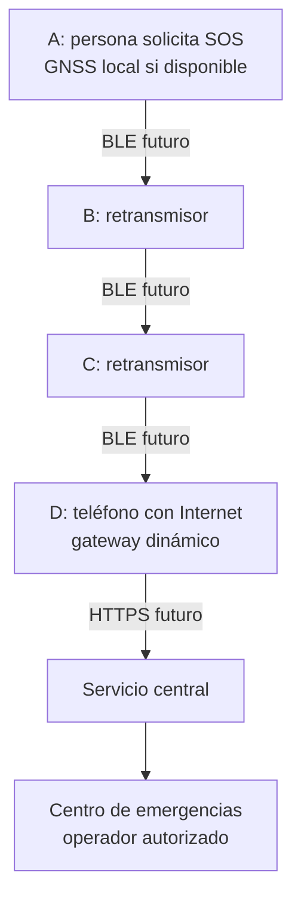

# 01 · Problema, objetivos y alcance

**Vetrabyte / Nicolás Butterfield · [MIT](../LICENSE) · Borrador para revisión · 16/10/2026**
[Índice](../README.md) · [Requerimientos](ERS-BeaconChat.md)

## Problema y propuesta

Después de una catástrofe, una persona puede conservar un teléfono funcional y carecer de red celular o Wi-Fi con salida a Internet. El centro de emergencias necesita conocer la solicitud, su ubicación y la calidad de esa información. La disponibilidad de vecinos y de un enlace de salida es una hipótesis por validar, no una característica asegurada del entorno.

**Enunciado orientativo de Vetrabyte, pendiente de contrastar con F-01:** registrar una solicitud SOS, intentar obtener ubicación GNSS local y hacerla circular mediante una red colaborativa de teléfonos hasta un nodo con Internet que remita el incidente a un servicio central. El operador podría visualizarlo y clasificarlo. [Issue #6](https://github.com/NicoButter/beaconchat/issues/6).

Todo este flujo integral es **P**. No todos los teléfonos necesitan Internet; A, B y C sí necesitan enlaces BLE efectivos con sus vecinos. D puede ser móvil y ganar o perder conectividad. Un retransmisor pasa información a otro vecino; un gateway cruza hacia el servicio por Internet. La red no crea conectividad donde no existe ningún enlace.

## Objetivos y evidencia esperada

| Objetivo | Alcance comprobable futuro |
| --- | --- |
| O-01 · Expresar una solicitud útil | SOS mínimo con ID, tipo, ubicación o ausencia explícita y procedencia de datos |
| O-02 · Extender la comunicación de proximidad | Cadena física con extremo fuera del alcance directo; comparar con cadena rota |
| O-03 · Alcanzar un servicio central | Registro idempotente con confirmación de servidor, separado del éxito GATT |
| O-04 · Permitir atención informada | Operador ve precisión, antigüedad, gravedad declarada y estado, con acceso restringido |
| O-05 · Reconocer límites y cuidar datos | Sin falsa confirmación; fallos visibles, controles de privacidad y medición de energía |

Los objetivos no declaran una reducción medida de tiempos de rescate ni tasas de entrega. Sus pruebas están en [06](Validacion-BeaconChat.md).

## Usuarios y actores

| Actor | Necesidad | Condición relevante |
| --- | --- | --- |
| Persona afectada o acompañante | Pedir ayuda y saber qué ocurrió con el envío | Estrés, posible lesión, poca batería, GNSS sin fix |
| Colaborador con teléfono | Participar como retransmisor | Consentimiento y límites de consumo; sin necesidad de ver coordenadas |
| Usuario de nodo gateway | Entregar al centro cuando haya Internet | Conectividad intermitente y credenciales futuras |
| Operador del centro | Ver y clasificar incidentes sin duplicarlos | Acceso autorizado, datos inciertos y responsabilidad humana |
| Brigadista / coordinador | Gestionar recursos y rutas | Extensión futura; no usar rutas sin verificar como seguras |
| Administrador del servicio | Mantener permisos, disponibilidad y retención | Rol propuesto, institución aún no definida |

## Matriz AS-IS / TO-BE

| Capacidad | AS-IS en `main` | TO-BE propuesto |
| --- | --- | --- |
| Texto BLE cercano | **E:** GATT directo A↔B, hasta 20 bytes totales `CALLSIGN:MENSAJE`; prueba física pendiente | Mantener compatibilidad y agregar transporte mesh versionado separado |
| Señalización SOS | **E:** luz, vibración, audio y beacons BLE; QR y receptores locales en código | Canales complementarios; no asimilar beacon a incidente geolocalizado |
| Retransmisión | **S:** MeshEngine con IDs/TTL/dedupe/cola temporal, simulaciones JVM | **P:** adaptación BLE, serialización, fragmentación y reensamblado, multisalto real |
| Ubicación | Sin georreferenciación de incidentes | **P:** GNSS, posición reciente con edad/precisión o ubicación manual identificada |
| Incidente SOS | Sin envelope rico | **P:** ID estable, tipo, ubicación opcional, tiempos, gravedad declarada y nota breve |
| Salida a Internet | Sin gateway ni backend; manifiesto sin permiso INTERNET | **P:** gateway dinámico por HTTPS y API autenticada |
| Corte prolongado | Chat en memoria; cola mesh temporal de un intento | **P:** almacenamiento durable, expiración y reintentos controlados (DTN) |
| Centro / mapas | Sin base central, mapa geográfico ni priorización | **P:** recepción, filtros, clasificación humana y posteriormente recursos |
| Seguridad | Callsign/MAC no autentican; sin seguridad propia extremo a extremo | **P:** autenticación, cifrado, autorización, retención y mitigación de falsos SOS |
| LoRa | Ausente | **P:** complemento opcional con radio/gateway externo, nunca requisito del MVP |

E/S no equivalen a ensayos de campo aprobados. [Arquitectura y fuentes de código](Diseño-Arquitectura-BeaconChat.md).

## Escenarios y degradación

| Escenario | Comportamiento objetivo | Limitación que debe mostrarse |
| --- | --- | --- |
| GNSS disponible, vecinos y gateway | A registra; B/C pasan; D entrega; centro confirma | La recepción central no confirma lectura ni rescate |
| Sin GNSS en interior/escombros | Ofrecer dato reciente rotulado, referencia manual o SOS sin ubicación | No usar coordenadas ficticias ni una posición vieja como actual |
| Sin vecinos o enlace roto | Mostrar que no hay ruta conocida ni entrega central | Señalización local puede estar disponible; no reemplaza el enlace faltante |
| Vecinos sin Internet | Mostrar salida no disponible; conservar/reintentar solo en futura fase durable | El MeshEngine actual no implementa esa recuperación |
| Gateway pierde Internet después de enviar | Reintentar con el mismo ID; servidor deduplica | Respuesta perdida deja estado incierto, no autoriza inventar éxito |
| Batería o permisos insuficientes | Comunicar funciones degradadas y detener recursos según política | No asegurar background continuo, GNSS ni publicidad en cualquier Android |

El GNSS puede obtener posición sin datos móviles porque recibe señales de satélites; disponibilidad y exactitud dependen de recepción, hardware, permisos y tiempo. La búsqueda asistida y los mapas pueden depender de servicios adicionales. No hay garantía de fix bajo escombros o en interiores. [Android · GPS_PROVIDER](https://developer.android.com/reference/android/location/LocationManager#GPS_PROVIDER), [GPS.gov · precisión y obstáculos](https://www.gps.gov/gps-accuracy).

## Límites del MVP conceptual

Incluye SOS con ubicación opcional y calidad explícita, tránsito BLE multisalto, gateway HTTPS y centro de laboratorio con visualización/clasificación humana. Se demuestra inicialmente con datos sintéticos y sin enlace a servicios oficiales. El formato y la integración aún deben construirse.

Las rutas bloqueadas, brigadistas, asignación de recursos, prioridad asistida, LoRa y cartografía descargable son extensiones. Persistencia durable/DTN es una etapa adicional explícita. La gravedad declarada no es diagnóstico ni triage automático; el envío o la recepción no prometen asistencia. No se declara homologación IEEE, NIST o ITU, alcance fijo ni transmisión asegurada a través de derrumbes.
