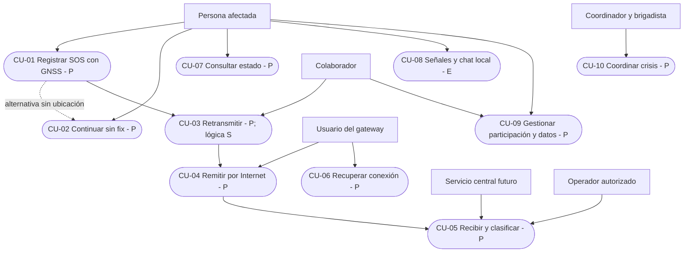
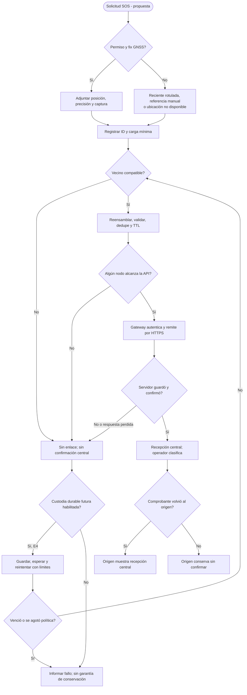

# 03 · Casos de uso

**Vetrabyte / Nicolás Butterfield · [MIT](../../LICENSE) · Borrador para revisión · 16/10/2026**
[Índice](../README.md) · [Requerimientos](02-requerimientos.md) · [Validación](06-validacion.md)

## Actores y mapa de interacción

Actores humanos: persona afectada/acompañante, colaborador, usuario del gateway, operador autorizado y futuro coordinador/brigadista. GNSS, dispositivo vecino y API central son actores técnicos respecto de la aplicación móvil. El teléfono puede asumir origen, retransmisor o gateway en momentos distintos. El centro no es un servicio oficial conectado en el prototipo.

Mermaid representa aquí las relaciones de casos de uso mediante un **flowchart** (no un tipo `usecaseDiagram`). Todos los casos integrales son P salvo los antecedentes E/S expresamente rotulados.

Los IDs completos son `R26-CU-01` a `R26-CU-10`; se abrevia el prefijo en diagramas para facilitar la lectura.

## R26-CU-01 · Registrar SOS con GNSS

**Estado:** P. **Actor:** persona afectada/acompañante. **Disparador:** solicita ayuda. **Precondiciones:** app futura operativa, energía y participación informada; GNSS disponible para el flujo normal. No se requiere Internet local ni se presupone una ruta.

1. La persona elige SOS y tipo; se muestra qué datos mínimos circularán y hacia quién.
2. La app solicita permiso de ubicación cuando corresponda e intenta GNSS durante un plazo acotado por configurar y medir.
3. Con fix, presenta precisión estimada y captura; admite gravedad declarada y nota breve opcional.
4. Registra un ID único y carga inmutable con tiempos, procedencia y edad de posición. La creación no equivale a transmisión.
5. Entrega al futuro adaptador mesh si hay vecinos; expone estado local y posibilidad de consultar evolución.

**Postcondición:** SOS registrado y tránsito intentado; recepción central aún no confirmada. En E3 la persistencia no se presume; custodia durable es E4.

**Alternativas/errores:** permiso denegado, timeout GNSS o posición de mala calidad conducen a CU-02. Sin vecinos, informa «sin enlace disponible», sin confirmación central. Carga inválida vuelve a edición; fallo al registrar se informa sin afirmar custodia. Un doble toque no debe generar incidentes distintos por accidente.

**Aceptación:** ID estable, campos válidos y metadatos visibles, ninguna ubicación inventada; pruebas PR-04/05/15. **RF:** 04, 05, 08, 13.

## R26-CU-02 · Continuar con GNSS no disponible

**Estado:** P. **Actor:** persona afectada. **Precondición:** CU-01 sin fix, permiso denegado o posición no utilizable. **Disparador:** vencimiento de espera o decisión de continuar sin GNSS.

1. La app explica que no obtuvo posición actual y permite continuar.
2. Si existe una posición reciente, muestra fuente, captura, precisión y antigüedad; la persona puede elegirla o descartarla. «Reciente» requiere umbral acordado; nunca ocultar edad.
3. Ofrece referencia manual textual; coordenadas manuales, si se admiten, se validan y rotulan como declaradas, sin precisión GNSS inventada.
4. Si no hay información, registra `ubicación no disponible` y crea el SOS con los demás datos mínimos.
5. Continúa el intento de tránsito. El centro futuro mantiene el incidente en lista aunque no pueda situarlo en el mapa.

**Postcondición:** SOS sin posición automática o con alternativa identificada. **Errores:** dato manual fuera de rango se rechaza; dato viejo conserva su edad; cancelar no produce envío. **Aceptación:** un SOS sin ubicación es válido; no se coloca un marcador falso ni se etiqueta como fix una referencia manual; PR-06/12/15. **RF:** 04, 06, 11.

## R26-CU-03 · Retransmitir por vecinos

**Estado:** P en hardware; núcleo S. **Actor:** dispositivo vecino, con participación autorizada por su usuario. **Precondiciones:** permisos BLE, enlaces efectivos, versión compatible, espacio/cuotas y futuro adaptador. **Disparador:** mensaje completo recibido.

1. El adaptador negocia versión/capacidad, reensambla de forma acotada y valida estructura e integridad.
2. El núcleo verifica identidad lógica, versión, TTL y `(originId, messageId)`.
3. Descarta duplicados retenidos; entrega localmente cuando corresponda y encola reenvío si queda TTL y capacidad.
4. El adaptador envía a vecinos elegibles, excluye origen inmediato y decrementa TTL una sola vez por salto lógico.
5. Registra resultado del intento sin interpretarlo como recepción del centro.

**Postcondición:** reenvío intentado o descarte explícito. **Errores:** fragmento faltante vence; paquete inválido se descarta sin envenenar dedupe; TTL agotado no reenvía; cola llena informa descarte; sin vecino se pasa a CU-06 solo cuando exista custodia durable. El núcleo actual consume el intento y no lo reencola.

**Aceptación:** cadena física sin enlace directo entre extremos; duplicados y bucles acotados; ninguna mezcla con chat legado; PR-02/07/08/09/16. **RF:** 03, 07, 12, 13.

## R26-CU-04 · Actuar como gateway dinámico

**Estado:** P. **Actor:** teléfono con Internet y credenciales futuras. **Precondiciones:** SOS válido recibido, rol habilitado y API accesible/autenticable. **Disparador:** recepción del SOS o retorno de conectividad.

1. El nodo comprueba acceso útil al endpoint; tener Wi-Fi no basta.
2. Remite el mismo SOS por HTTPS con autenticación y clave idempotente.
3. Espera respuesta central válida, correlacionada con ID y persistencia del incidente.
4. Marca recepción central en el gateway. Una futura ruta de retorno puede trasladar el comprobante al emisor.

**Postcondición:** recepción central confirmada en ese nodo, o resultado pendiente/fallido. **Errores:** DNS/TLS, credencial revocada, servidor caído o respuesta perdida no producen éxito; con fase durable se conserva y reintenta bajo política. Otro teléfono puede convertirse en gateway; el servidor deduplica ambos.

**Aceptación:** el primer nodo con Internet útil puede salir, sin exigir Internet al resto; pérdida de respuesta no duplica incidente ni confirma al origen sin retorno; PR-10/11/14. **RF:** 08, 09, 10, 12, 13.

## R26-CU-05 · Recibir, visualizar y clasificar en el centro

**Estado:** P. **Actores:** API y operador autorizado. **Precondiciones:** futuro servidor desplegado en laboratorio y operador de prueba; para operación real, institución y responsabilidades definidas. **Disparador:** recepción HTTPS.

1. API autentica, valida contenido/origen según política y busca la clave estable del SOS.
2. Crea transaccionalmente un incidente o recupera el ya registrado; mismo ID con contenido conflictivo se rechaza/audita.
3. Emite comprobante después de guardar; no después de solo recibir en memoria.
4. Operador entra por rol y ve lista/mapa y filtros de tiempo, gravedad declarada y estado.
5. Distingue dato manual, viejo o no disponible y registra clasificación humana con autor y fecha.

**Postcondición:** incidente central único y revisión registrada si el operador actuó. **Errores:** fallo de base no confirma; acceso no autorizado se deniega; coordenadas ausentes no impiden lista; gravedad declarada no se interpreta como triage clínico; atención/asignación no se crean por recibir un paquete.

**Aceptación:** dos gateways no duplican; UI respeta incertidumbre y roles; PR-11/12/14. **RF:** 10, 11, 13.

## R26-CU-06 · Recuperar conexión y custodia durable

**Estado:** P, etapa E4; **no existe en el MeshEngine actual**. **Actor:** emisor, retransmisor o gateway. **Precondiciones:** almacenamiento durable habilitado, cuotas, expiración y política de reintentos aprobadas. **Disparador:** falta o retorno de vecino/Internet; reinicio.

1. Guarda la solicitud vigente de forma atómica antes de informar «guardado localmente».
2. Programa intentos acotados con espera creciente y variación para evitar reenvíos sincronizados.
3. Al volver un enlace, intenta transferir con la misma clave/carga y presupuesto de saltos establecido.
4. Recupera pendientes tras reinicio; procesa comprobante central verificable cuando existe.
5. Expira o borra según política e informa el estado conocido; no reinicia TTL para circular indefinidamente.

**Postcondición:** entrega intentada tras reconexión, custodia vigente o expiración comunicada. **Errores:** almacenamiento lleno/fallo de escritura no anuncia custodia; reloj civil incorrecto exige tratamiento explícito de edad/expiración; batería agotada no garantiza continuidad. **Aceptación:** reinicio conserva pendientes aceptados, expirados no salen, dedupe central persiste; PR-09/10/13/16. **RF:** 08, 09, 10, 12.

## R26-CU-07 · Consultar el estado de una solicitud

**Estado:** P; el chat directo E solo confirma escritura GATT. **Actor:** emisor. **Precondición:** SOS registrado. **Disparador:** abre su estado.

1. Ve si se creó localmente, si hay un intento de tránsito y el último resultado conocido.
2. Si el comprobante central llegó y es válido, ve «recibido por el centro» con correlación/tiempo.
3. Sin comprobante, mantiene «recepción central sin confirmar» aunque un vecino haya aceptado o el gateway haya enviado.

**Errores:** comprobante ajeno/corrupto se rechaza; ausencia de retorno no prueba que la API no recibió. **Postcondición:** estado respaldado por evidencia, sin promesa de lectura o rescate. **Aceptación:** cero falsos éxitos en fallos inducidos; PR-10/11/15. **RF:** 01, 08.

## R26-CU-08 · Usar chat y señalización local

**Estado:** E en código, validación física pendiente. **Actor:** usuario cercano. **Precondiciones:** permisos y hardware para el canal elegido. **Disparador:** SOS/HELP local, transmisión/recepción o chat directo.

1. Selecciona señal local y la detiene cuando corresponde, o descubre un peer BLE y envía texto dentro del límite de bytes.
2. La app usa los controladores/emisores y receptores existentes; el chat expone callback GATT como confirmación de escritura.
3. Al pausar/salir se liberan recursos conforme al flujo actual; el historial de chat es temporal.

**Errores:** sin permiso/hardware, fuera de alcance, límite superado o timeout; no agregar envío fallido como exitoso. **Postcondición:** emisión/intento local, sin geolocalización ni entrega a centro. **Aceptación:** PR-01/03, con ensayo por canal. **RF:** 01, 02. No se presupone transmisión a través de escombros ni disponibilidad de todos los emisores.

## R26-CU-09 · Gestionar participación y datos

**Estado:** P. **Actor:** participante o administrador autorizado. **Precondición:** política comprensible y roles definidos. **Disparador:** activar colaboración/SOS o gestionar retención.

1. Explica datos, finalidad, destino, consumo y límites; permite decidir permisos y rol retransmisor/gateway.
2. Una política de emergencia específica debe definir el tratamiento cuando no sea viable un consentimiento habitual; su revisión corresponde al responsable institucional, aún no definido.
3. Autentica roles, limita acceso a coordenadas y permite detener la participación futura.
4. Aplica retención/borrado y auditoría mínima; comunica que detener emisiones locales no retira copias ya transmitidas ni cierra incidentes centrales automáticamente.

**Errores:** rol insuficiente deniega acceso; revocación y fallo de borrado quedan registrados sin exponer carga sensible. **Postcondición:** permisos/retención aplicados según política verificable. **Aceptación:** PR-14/15; ninguna captura pública con datos reales. **RF:** 13.

## R26-CU-10 · Coordinar crisis y enlaces complementarios

**Estado:** P, extensión E4–E5. **Actores:** coordinador, brigadista y operador de radio externo. **Precondiciones:** centro y validación básica aprobados, roles y protocolos de operación acordados. **Disparador:** necesidad de recursos o ruta alternativa.

1. Registra disponibilidad de brigadistas/recursos y reportes de rutas bloqueadas con fuente y edad.
2. El coordinador revisa datos y asigna recursos; toda prioridad asistida requiere supervisión humana.
3. Si se ensaya LoRa, usa equipo externo compatible e intercambia mensajes preservando identidad/dedupe.

**Errores:** datos contradictorios o viejos quedan marcados; sin radio externa LoRa no existe y se conserva la alternativa BLE; no certificar rutas seguras. **Postcondición:** decisión humana auditable o limitación visible. **Aceptación:** PR-17/18. **RF:** 14, 15.

## Actividad propuesta: normal y fallos

Este ciclo ilustra la política **propuesta**; la cola actual no ejecuta STORE ni reintenta. La implementación futura debe separar temporizadores, expiración e intentos sin mantener un bucle activo ilimitado.
