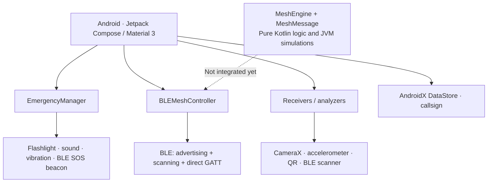
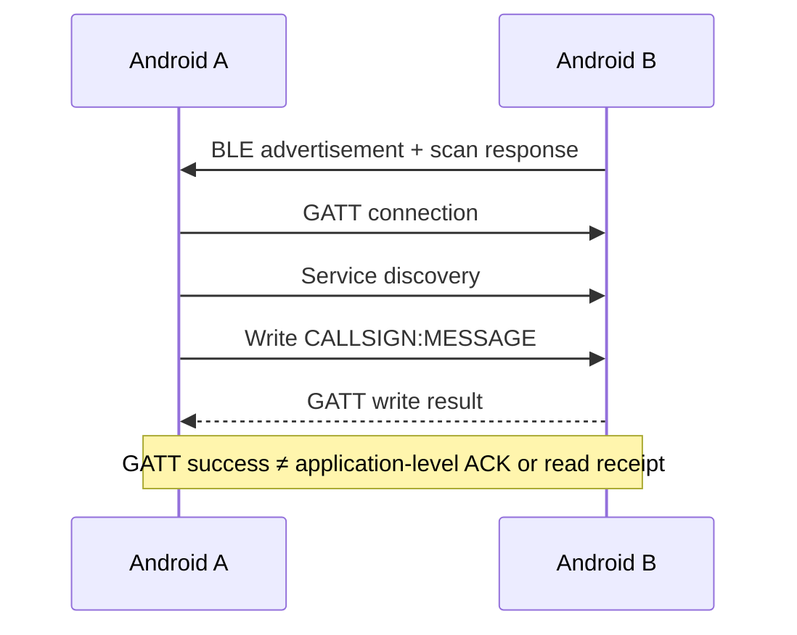
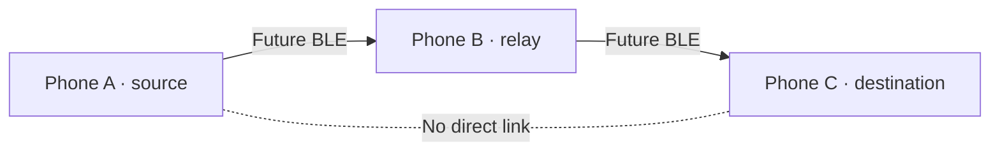

# BeaconChat 📡

<p align="center"></p>
<p align="center"><a href="https://vetrabyte.com.ar/"></a></p>
<p align="center"><strong>Alternative communication and emergency signaling without Internet access</strong><br>
A <a href="https://vetrabyte.com.ar">Vetrabyte</a> project · Nicolás Butterfield · <a href="mailto:nicobutter@gmail.com">Contact</a></p>
<p align="center"><a href="README.md">Español</a> · <strong>English</strong> · <a href="LICENSE">MIT License</a></p>

> **Status: experimental prototype.** BeaconChat implements several local signaling and communication methods for Android devices. It is not a certified rescue device, emergency beacon, or replacement for official emergency communications. Some features exist in code but still need physical-device and field testing.

## What is BeaconChat for?

Even without cellular data or Wi-Fi, smartphones have useful local hardware: Bluetooth Low Energy (BLE), camera, flashlight, speaker, vibration motor, and accelerometer. BeaconChat explores **short-range message exchange** and **signal transmission/detection** without a central server or Internet connection.

Every medium has constraints: BLE requires compatible radios within range; light needs visibility; tactile communication requires suitable physical coupling; audio depends on the environment and phone hardware. **“Offline” does not mean that no physical communication link is needed.**

## Features and verified scope

| Feature | Purpose | Current status |
| --- | --- | --- |
| Direct BLE chat | Peer discovery plus short GATT messages | Implemented; **A↔B physical test pending** |
| Direct BLE protocol | UTF-8 `CALLSIGN:MESSAGE` frames up to **20 bytes total** | Unit tests reported; no fragmentation |
| Logical mesh core | Stable node/message identities, TTL, bounded dedupe, FIFO queue, simulated transport | **31 new JVM tests reported**; not connected to BLE |
| Multi-hop A→B→C | Actual relay across Android devices | **Not implemented on hardware** |
| Emergency BLE beacon | BLE advertisement-based emergency signal transmission/detection | Implemented in code; range/reliability not certified |
| Optical Morse | Flashlight encoding and camera decoding | Implemented in code; scenario-specific testing needed |
| Haptics / accelerometer | Tactile signaling and vibration detection | Implemented in code; requires favorable physical conditions |
| Sound | Tone-based signaling | Experimental; device-dependent |
| QR codes | QR generation and scanning | Implemented in code |
| DataStore | Persistent callsign preference | Implemented |
| Durable chat history, app-level end-to-end ACK, custom encryption, guaranteed delivery | Not available for current direct BLE chat | Planned or out of scope |

Work for [Issue #1](https://github.com/NicoButter/beaconchat/issues/1) and [Issue #2](https://github.com/NicoButter/beaconchat/issues/2) is now merged into `main`. **17 tests** for #1 and **48 total tests** for #2 were reported in Codex execution notes; these are not independent certification or field test results.

## Architecture



### Direct BLE: what a successful write actually means



### Multi-hop: a future hardware objective, not a working BLE feature



The logical core validates incoming messages, deduplicates by `(originId, messageId)`, decides local delivery, decrements TTL and queues potential forwarding. These behaviors are covered through simulated network topologies only. **No multi-hop BLE relay or mesh frame fragmentation is currently integrated.** Logical messages may exceed the 20-byte current GATT packet budget.

## Technologies and dependencies

Actual versions declared by the source build configuration:

| Technology / library | Version / setting | Purpose |
| --- | --- | --- |
| Kotlin | 1.8.22 | Android app and logical mesh core |
| Android Gradle Plugin | 8.13.1 | Android build tooling |
| Gradle Wrapper | 8.13 | Build runner |
| Android SDK | `compileSdk 34`, `targetSdk 34`, `minSdk 24` | Android **7.0+** declared; actual hardware compatibility varies |
| Jetpack Compose / Material 3 | Compose BOM 2023.06.01 | UI |
| AndroidX Core / Activity / Lifecycle | See version catalog | Platform and lifecycle |
| Kotlin Coroutines / StateFlow | Project Kotlin/AndroidX dependencies | Concurrency/reactive state |
| CameraX | 1.3.0-rc01 | Camera analysis |
| Google Guava | 31.1-android | Utility library |
| DataStore Preferences | 1.0.0 | Persisted preferences |
| ZXing Core | 3.5.2 | QR encoding/decoding |
| JourneyApps ZXing Embedded | 4.3.0 | QR scanning integration |
| JUnit | 4.13.2 | JVM unit tests |
| AndroidX Test / Espresso | Version catalog | Instrumented tests |

The source of truth is [`app/build.gradle.kts`](app/build.gradle.kts), [`gradle/libs.versions.toml`](gradle/libs.versions.toml), and [`gradle/wrapper/gradle-wrapper.properties`](gradle/wrapper/gradle-wrapper.properties).

### Protocols and standard references

- **BLE:** GAP advertising/scanning plus GATT/ATT characteristic writes. BeaconChat defines its own service UUIDs for chat (`0000BEEF-...`) and emergency beacons (`0000BECE-...`). **It does not implement the Bluetooth Mesh Profile.**
- **International Morse code:** **ITU-R M.1677** is relevant to international Morse coding, not an endorsement or certification of BeaconChat's optical framing or nine additional writing systems.
- **Visible light communication:** IEEE 802.15.7 is a relevant technical reference. **No tested compliance is claimed.**
- **NIST/ASTM or rescue technology:** references to these domains are **not certification or endorsement**.

## Build and physical testing

Development requires **JDK 17 or 21** and Android SDK 34. The Gradle wrapper fetches its declared distribution. Initial Gradle dependency downloads may require Internet; the phones do not require mobile Internet for BLE testing.

```bash
git clone https://github.com/NicoButter/beaconchat.git
cd beaconchat

./gradlew testDebugUnitTest assembleDebug
# APK: app/build/outputs/apk/debug/app-debug.apk

adb devices
adb install -r app/build/outputs/apk/debug/app-debug.apk
```

To test **A↔B**, install the same APK on two BLE-capable Android phones, enable airplane mode, manually turn Bluetooth back on while keeping Wi-Fi off, choose distinct callsigns, discover peers and exchange short messages in both directions. Android 6–11 may also require location permission and location services. Full procedure: [`docs/PRUEBA_BLE_DIRECTO.md`](docs/PRUEBA_BLE_DIRECTO.md).

**Hardware requirements vary by feature:** the manifest declares BLE as required; optical features need a camera/flash; tactile features rely on an accelerometer and vibration motor. Physical device testing is still pending. The Issue #1 report lists 48 existing Lint errors in unchanged optical modules; these are not evidence of failed direct BLE tests.

The optional `Makefile` and `deploy-to-phone.sh` currently hardcode a Fedora-specific `JAVA_HOME`; use the Gradle wrapper commands above with the JDK configured for your machine for a portable workflow.

## Repository documentation

- [Android/Kotlin source](app/src/main/java/com/nicobutter/beaconchat/)
- [Architecture inventory](docs/ARCHITECTURE.md) (some historical details may remain)
- [Direct BLE A↔B field-test procedure](docs/PRUEBA_BLE_DIRECTO.md)
- [Logical mesh core, tests and BLE frame budget](docs/ISSUE_2_MESH_CORE.md)
- [Optical protocol notes](PROTOCOLO_OPTICO.md) (empirical claims are not independent certification)
- [Software engineering specifications](PSI/)
- [Spanish README](README.md)

## Roadmap

1. **Direct A↔B BLE:** merged, awaiting physical tests.
2. **Logical mesh core:** merged and exercised in JVM simulations, not wired to BLE.
3. **A→B→C physical integration:** define framing, fragmentation/reassembly, compatibility, forwarding and three-phone tests.
4. Future work based on evidence: acknowledgments, identity, security, reliability and field evaluation.

## Author, contributions and license

**BeaconChat is a [Vetrabyte](https://vetrabyte.com.ar) project developed by Nicolás Butterfield.**

- **Email:** [nicobutter@gmail.com](mailto:nicobutter@gmail.com)
- **GitHub:** [github.com/NicoButter/beaconchat](https://github.com/NicoButter/beaconchat)
- **License:** [MIT](LICENSE). Use, modification, redistribution and commercial use are allowed under its conditions, including preservation of copyright and license notices. The original `LICENSE` remains unchanged.
- **Contributing:** open an Issue, work in a focused branch and submit a Pull Request with test evidence and documented limitations. Credit each contributor's work.

## Safety notice

BeaconChat is **experimental**. It does not guarantee availability, cryptographic sender authentication, app-level custom encryption, end-to-end delivery acknowledgments, delivery reliability or certified rescue functionality. BLE, optical, sound and vibration methods can fail due to hardware, power, permissions, interference and environmental conditions. **Do not rely on BeaconChat as your sole emergency communication method; use official emergency services whenever possible.**
