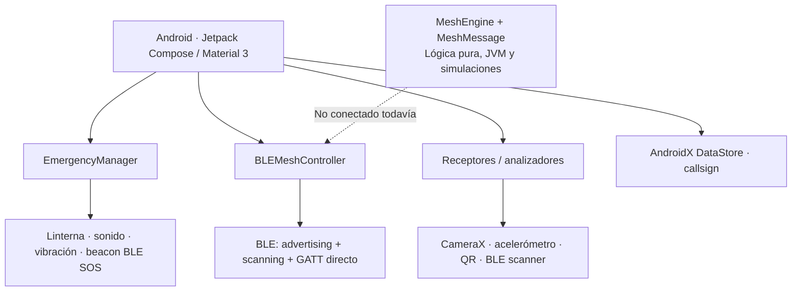
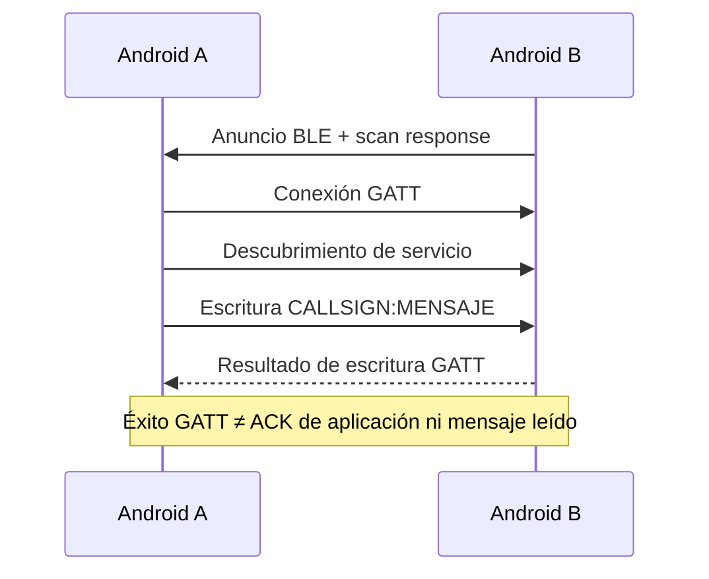
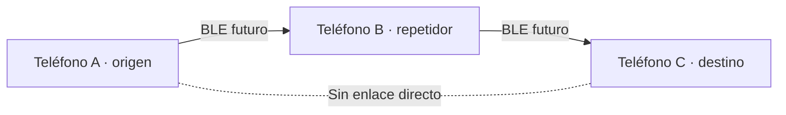

# BeaconChat 📡

<p align="center"></p>
<p align="center"><strong>Comunicación alternativa y señalización de emergencia sin Internet</strong><br>
Proyecto de <a href="https://vetrabyte.com.ar">Vetrabyte</a> · Nicolás Butterfield · <a href="mailto:nicobutter@gmail.com">Contacto</a></p>
<p align="center"><strong>Español</strong> · <a href="README.en.md">English</a> · <a href="LICENSE">Licencia MIT</a></p>

> **Estado: prototipo experimental.** BeaconChat implementa distintos canales locales de señalización y comunicación entre dispositivos Android. No es un servicio de rescate, una radiobaliza certificada ni un sustituto de comunicaciones de emergencia oficiales. Algunas funciones están implementadas en código pero siguen pendientes de validación sobre dispositivos y en condiciones de campo.

## ¿Qué problema busca resolver?

Durante un corte de conectividad móvil o Wi-Fi, varios componentes de un teléfono siguen disponibles: Bluetooth Low Energy (BLE), cámara, linterna, parlante, vibrador y acelerómetro. BeaconChat explora cómo utilizarlos para **intercambiar mensajes de proximidad** y **emitir/detectar señales** sin servidor central ni conexión a Internet.

Los canales tienen limitaciones diferentes: BLE exige alcance radioeléctrico y hardware compatible; la luz requiere visibilidad; la vibración necesita acoplamiento físico favorable; el audio depende del ambiente y de la capacidad del dispositivo. **«Sin Internet» no significa «sin ningún enlace físico».**

## Funcionalidades y estado real

| Componente | Qué hace | Estado |
| --- | --- | --- |
| Comunicación BLE directa | Descubre pares y envía texto breve por advertising/scanning + GATT | Implementada; **prueba física A↔B pendiente** |
| Protocolo BLE directo | Valida paquetes `CALLSIGN:MENSAJE` UTF-8 de **hasta 20 bytes en total** | Tests unitarios reportados; sin fragmentación |
| Núcleo mesh lógico | IDs de nodo/mensaje independientes, TTL, deduplicación temporal, cola FIFO y transporte simulado | **31 tests JVM nuevos reportados**; **no integrado al BLE** |
| Retransmisión multisalto A→B→C | Reenvío entre teléfonos fuera de alcance directo | **No implementado en dispositivos** |
| Beacon BLE de emergencia | Emisión/detección de señales de emergencia mediante anuncios BLE | Implementado en código; alcance/fiabilidad sin certificación |
| Luz / Morse | Codificación con linterna y detección con cámara | Implementado en código; requiere validación física por escenario |
| Vibración / acelerómetro | Señalización táctil y análisis de vibraciones | Implementado en código; requiere acoplamiento físico y pruebas |
| Sonido | Generación de tonos para señales | Experimental; audibilidad y rendimiento dependen del hardware |
| QR | Generación y lectura de códigos QR | Implementado en código |
| Preferencias | Almacena el callsign con AndroidX DataStore | Implementado |
| Historial permanente, ACK extremo a extremo, cifrado propio, entrega garantizada | No disponibles en el chat BLE actual | Pendiente / fuera del alcance presente |

En los Issues [#1](https://github.com/NicoButter/beaconchat/issues/1) y [#2](https://github.com/NicoButter/beaconchat/issues/2) están los requisitos. Sus implementaciones se integraron a `main`; los resultados de **17 tests** (#1) y **48 tests totales** (#2) provienen de los informes de ejecución de Codex, no de una certificación ni de ensayos de campo.

## Arquitectura



### BLE directo: qué confirma realmente el envío



### Mesh multisalto: objetivo, todavía no disponible en teléfonos



El motor lógico contempla recepción, validación, deduplicación de `(originId, messageId)`, entrega local, decremento de TTL y cola de reenvío. Hoy esas decisiones se verifican mediante topologías simuladas: **no hay retransmisión BLE multisalto ni fragmentación de frames mesh**. Su formato lógico puede exceder los 20 bytes del transporte actual.

## Tecnologías y dependencias

Valores declarados en el código de esta rama:

| Tecnología / librería | Versión o referencia | Uso |
| --- | --- | --- |
| Kotlin | 1.8.22 | Lenguaje Android y núcleo mesh |
| Android Gradle Plugin | 8.13.1 | Compilación Android |
| Gradle Wrapper | 8.13 | Herramienta de build |
| Android SDK | `compileSdk 34`, `targetSdk 34`, `minSdk 24` | Android **7.0+** a nivel de configuración; compatibilidad real depende del hardware |
| Jetpack Compose + Material 3 | Compose BOM 2023.06.01 | Interfaz declarativa |
| AndroidX Core / Activity / Lifecycle | Catálogo `gradle/libs.versions.toml` | API Android y ciclo de vida |
| Kotlin Coroutines / StateFlow | Dependencias Kotlin/AndroidX del proyecto | Concurrencia y estado reactivo |
| CameraX | 1.3.0-rc01 | Captura y análisis de frames |
| Google Guava | 31.1-android | Utilidades |
| DataStore Preferences | 1.0.0 | Configuración persistente |
| ZXing Core | 3.5.2 | Codificación/decodificación QR |
| JourneyApps ZXing Embedded | 4.3.0 | Integración de lectura QR |
| JUnit | 4.13.2 | Pruebas JVM |
| AndroidX Test / Espresso | Versiones del catálogo Gradle | Pruebas instrumentadas |

La fuente de verdad de versiones es [`app/build.gradle.kts`](app/build.gradle.kts), [`gradle/libs.versions.toml`](gradle/libs.versions.toml) y [`gradle/wrapper/gradle-wrapper.properties`](gradle/wrapper/gradle-wrapper.properties), no una cifra fija en la documentación.

### Protocolos y referencias normativas

- **Bluetooth Low Energy (BLE):** publicidad y escaneo (GAP) y escritura a características sobre GATT/ATT; BeaconChat utiliza UUID propios para chat (`0000BEEF-...`) y señales SOS (`0000BECE-...`). **No implementa Bluetooth Mesh Profile**.
- **Morse internacional:** referencias como **ITU-R M.1677** son pertinentes para el código Morse internacional; los alfabetos adicionales y el encuadre óptico de BeaconChat son implementaciones propias y **no implican certificación ITU**.
- **Comunicación por luz visible:** IEEE 802.15.7 es una referencia de ese campo; **BeaconChat no declara conformidad ensayada** con dicho estándar.
- **NIST/ASTM y tecnologías de rescate:** son áreas de referencia, **no avales ni certificaciones del producto**.

## Compilación y prueba

Requisitos de desarrollo: **JDK 17 o 21**, Android SDK 34 instalado y herramientas Android configuradas. Gradle Wrapper se descarga según el archivo incluido en el repositorio. Compilar no requiere conexión móvil de los teléfonos; la primera descarga de dependencias de Gradle sí puede necesitar Internet.

```bash
git clone https://github.com/NicoButter/beaconchat.git
cd beaconchat

./gradlew testDebugUnitTest assembleDebug
# APK: app/build/outputs/apk/debug/app-debug.apk

adb devices
adb install -r app/build/outputs/apk/debug/app-debug.apk
```

Para probar **A↔B**, instalar la misma APK en dos Android con BLE, activar modo avión y luego reactivar manualmente Bluetooth (mantener Wi-Fi apagado); configurar callsigns diferentes, buscar pares y enviar mensajes breves en ambas direcciones. En Android 6–11 pueden requerirse permiso y ubicación habilitados. Procedimiento detallado: [`docs/PRUEBA_BLE_DIRECTO.md`](docs/PRUEBA_BLE_DIRECTO.md).

**Importante:** la app exige BLE en el manifiesto; para funciones ópticas necesita cámara/flash y para táctiles depende de sensores y vibrador. Las pruebas en Android reales todavía están pendientes. El informe del Issue #1 señala además 48 errores de Lint en módulos ópticos no modificados; no son pruebas BLE fallidas.

Los scripts `Makefile` y `deploy-to-phone.sh` tienen hoy un `JAVA_HOME` específico de Fedora: para una compilación portable se recomienda el wrapper mostrado arriba y configurar el JDK según el equipo.

## Organización del repositorio

- [`app/src/main/java/com/nicobutter/beaconchat/`](app/src/main/java/com/nicobutter/beaconchat/): app y lógica Kotlin.
- [`docs/ARCHITECTURE.md`](docs/ARCHITECTURE.md): inventario de componentes (puede contener información histórica).
- [`docs/PRUEBA_BLE_DIRECTO.md`](docs/PRUEBA_BLE_DIRECTO.md): protocolo de prueba con dos Android.
- [`docs/ISSUE_2_MESH_CORE.md`](docs/ISSUE_2_MESH_CORE.md): motor mesh, presupuestos de bytes, simulaciones y límites.
- [`PROTOCOLO_OPTICO.md`](PROTOCOLO_OPTICO.md): diseño del canal óptico; los resultados empíricos no deben interpretarse como certificación independiente.
- [`PSI/`](PSI/): documentación de ingeniería de software y requisitos.
- [`README.en.md`](README.en.md): versión inglesa.

## Roadmap

1. **BLE A↔B:** integrado en código, pendiente de prueba con hardware.
2. **Núcleo mesh lógico:** integrado y cubierto por simulaciones JVM; sin adaptador BLE.
3. **Integración física A→B→C:** definir serialización, fragmentación/reensamblado, compatibilidad y retransmisión; luego probar en tres equipos.
4. Mejorar confirmaciones, identidad, seguridad, fiabilidad y validación de campo según evidencia.

## Autor, colaboración y licencia

**BeaconChat es un proyecto de [Vetrabyte](https://vetrabyte.com.ar), desarrollado por Nicolás Butterfield.**

- **Contacto:** [nicobutter@gmail.com](mailto:nicobutter@gmail.com)
- **Repositorio:** [github.com/NicoButter/beaconchat](https://github.com/NicoButter/beaconchat)
- **Licencia:** [MIT](LICENSE). Se permite usar, modificar, distribuir y comercializar bajo las condiciones de la licencia, conservando sus avisos de copyright y licencia. El texto original de `LICENSE` se mantiene intacto.
- **Colaboraciones:** abrir un Issue con el problema, proponer una rama pequeña y enviar un Pull Request con pruebas y limitaciones conocidas. Reconocer la autoría y aportes de cada contribuyente.

## Aviso de seguridad

Esta aplicación es **experimental**. No ofrece disponibilidad garantizada, autenticación criptográfica del emisor, cifrado propio del protocolo, entrega confirmada extremo a extremo ni prestaciones certificadas de rescate. BLE, luz, audio y vibración pueden fallar según permisos, batería, hardware, obstáculos e interferencias. **No dependas exclusivamente de BeaconChat en una emergencia; usá primero los servicios oficiales cuando estén disponibles.**
