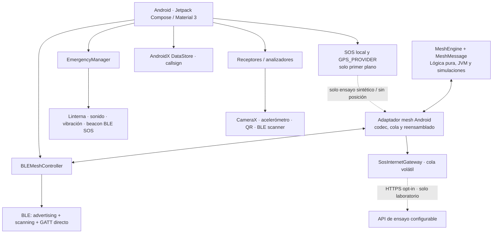
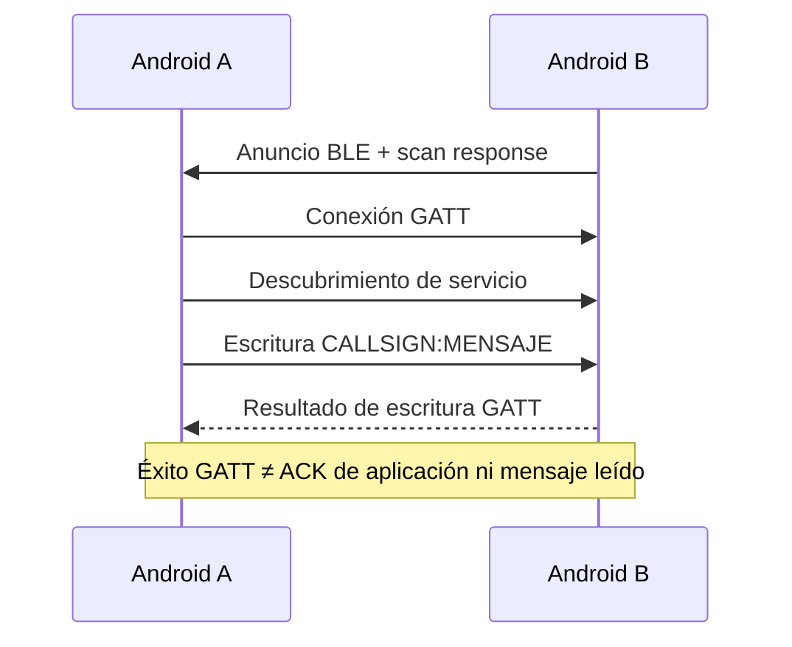
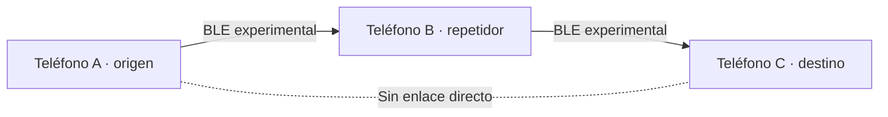
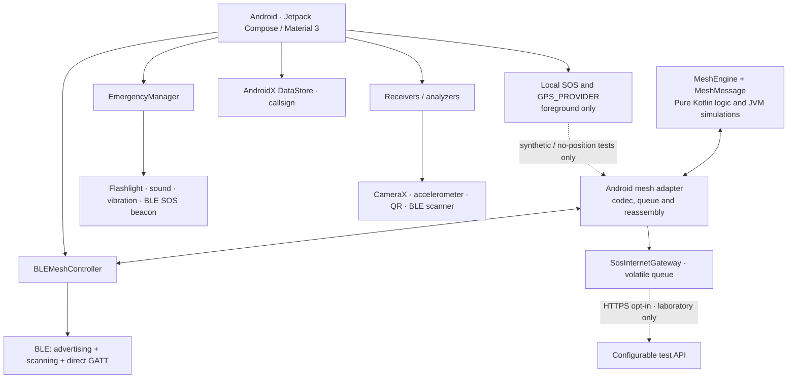
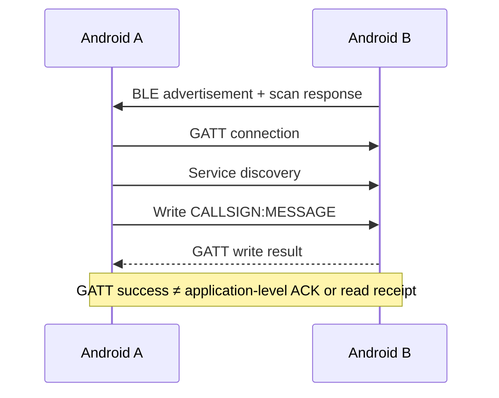
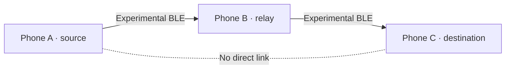

# BeaconChat 📡

<p align="center"></p>
<p align="center"><a href="https://vetrabyte.com.ar/"></a></p>
<p align="center"><strong>Comunicación alternativa y señalización de emergencia sin Internet</strong><br>
Proyecto de <a href="https://vetrabyte.com.ar">Vetrabyte</a> · Nicolás Butterfield · <a href="mailto:nicobutter@gmail.com">Contacto</a></p>
<p align="center"><strong>Español</strong> · <a href="#english">English</a> · <a href="LICENSE">Licencia MIT</a></p>

> **Estado: prototipo experimental.** BeaconChat implementa distintos canales locales de señalización y comunicación entre dispositivos Android. No es un servicio de rescate, una radiobaliza certificada ni un sustituto de comunicaciones de emergencia oficiales. Algunas funciones están implementadas en código pero siguen pendientes de validación sobre dispositivos y en condiciones de campo.

## 🎬 Video institucional

[](https://youtu.be/DCazWm7UWt4)

▶️ **[Ver BeaconChat en YouTube](https://youtu.be/DCazWm7UWt4)**

Una presentación audiovisual de BeaconChat, sus tecnologías de comunicación local y la **propuesta futura** de transmitir solicitudes SOS con ubicación GPS/GNSS a través de dispositivos vecinos hasta un nodo con acceso a Internet. Las escenas de red mesh multisalto y del centro de emergencias son **representaciones conceptuales**, no una demostración de esas funciones operando en teléfonos reales.

## ¿Qué problema busca resolver?

Durante un corte de conectividad móvil o Wi-Fi, varios componentes de un teléfono siguen disponibles: Bluetooth Low Energy (BLE), cámara, linterna, parlante, vibrador y acelerómetro. BeaconChat explora cómo utilizarlos para **intercambiar mensajes de proximidad** y **emitir/detectar señales** sin servidor central ni conexión a Internet.

Los canales tienen limitaciones diferentes: BLE exige alcance radioeléctrico y hardware compatible; la luz requiere visibilidad; la vibración necesita acoplamiento físico favorable; el audio depende del ambiente y de la capacidad del dispositivo. **«Sin Internet» no significa «sin ningún enlace físico».**

## Funcionalidades y estado real

| Componente | Qué hace | Estado |
| --- | --- | --- |
| Comunicación BLE directa | Descubre pares y envía texto breve por advertising/scanning + GATT | Implementada; **prueba física A↔B pendiente** |
| Protocolo BLE directo | Valida paquetes `CALLSIGN:MENSAJE` UTF-8 de **hasta 20 bytes en total** | Tests unitarios reportados; sin fragmentación |
| Núcleo y transporte mesh Android | IDs lógicos, TTL, deduplicación, codec V1, fragmentos ≤20 bytes, reensamblado y GATT dedicado | Implementados e integrados; política probada con GATT falso; **radio física pendiente** |
| Retransmisión multisalto A→B→C | Cola acotada y reenvío por vecinos con identidad declarada por sesión | Ruta Android implementada; cadena/diamante/anillo simulados; **no validado entre teléfonos** |
| SOS estructurado offline | UUID estable, tipo/gravedad declarada, creación, nota y ubicación opcional; codec de hasta 433 bytes | Implementado; **39 tests JVM nuevos** de SOS/GNSS/privacidad/integración |
| GPS/GNSS local | `LocationManager.GPS_PROVIDER`, permiso preciso, timeout y cancelación; distingue fix reciente, conocido y ausencia | Componente Android implementado; **captura satelital real no verificada** |
| Laboratorio SOS mesh | Ensayos con posición sintética fija o sin posición; interpretación del SOS al recibir | Integrado en Mesh Radar; **SOS con coordenadas GNSS reales bloqueados** en origen y relay |
| Gateway HTTPS de laboratorio | Observa SOS aceptados, deduplica incidentes y valida comprobantes correlacionados | Implementado; GATT/API falsos probados; **desactivado por defecto y sin servidor incorporado** |
| Beacon BLE de emergencia | Emisión/detección de señales de emergencia mediante anuncios BLE | Implementado en código; alcance/fiabilidad sin certificación |
| Luz / Morse | Codificación con linterna y detección con cámara | Implementado en código; requiere validación física por escenario |
| Vibración / acelerómetro | Señalización táctil y análisis de vibraciones | Implementado en código; requiere acoplamiento físico y pruebas |
| Sonido | Generación de tonos para señales | Experimental; audibilidad y rendimiento dependen del hardware |
| QR | Generación y lectura de códigos QR | Implementado en código |
| Preferencias | Almacena el callsign con AndroidX DataStore | Implementado |
| Historial permanente, ACK extremo a extremo, cifrado propio, entrega garantizada | No disponibles en el chat BLE actual | Pendiente / fuera del alcance presente |

En los Issues [#1](https://github.com/NicoButter/beaconchat/issues/1) y [#2](https://github.com/NicoButter/beaconchat/issues/2) están los requisitos iniciales. La base de **183 tests JVM** se reejecutó antes de #6; el gateway eleva la suite a **225 aprobados (183 + 42), sin fallos**, con APK debug compilada en Gradle 8.13/JDK 21. Son simulaciones y evidencia de compilación, **no ensayos físicos de GPS/BLE/HTTPS ni certificación**. [Contrato, archivos y evidencia](PSI/Validacion-BeaconChat.md).

## Arquitectura



### BLE directo: qué confirma realmente el envío



### Mesh multisalto: código integrado, validación física pendiente



El motor valida, deduplica por `(originId, messageId)`, entrega localmente y descuenta TTL una vez por salto. Su adaptador Android intercambia identidades declaradas, fragmenta en tramas de hasta 20 bytes y usa escrituras/recibos secuenciales con límites y timeout. El chat directo conserva su característica y formato anteriores. **Admitido en cola y escrito en enlace no confirman entrega al destino final.** Las identidades declaradas y CRC32 no aportan autenticación ni cifrado.

### Laboratorio SOS offline

En **Mesh Radar → Laboratorio SOS offline** se puede solicitar GPS con espera configurable de 1–120 s, crear un SOS local con la posición disponible o sin coordenadas y preparar por separado ensayos mesh. Android 12+ requiere pedir ubicación precisa y aproximada juntas; si solo se concede aproximada, el laboratorio informa que no dispone de GPS preciso y permite continuar sin posición. No se solicita ubicación en segundo plano ni se usan Wi-Fi, datos, geocodificación o mapas.

La posición real y la nota local no se copian al ensayo. El envío permite únicamente SOS de laboratorio con una posición sintética fija (`12.3456, -45.6789`) o sin ubicación. Cada reintento conserva UUID y contenido del incidente; cada intento mesh tiene su propio ID. La captura se cancela al pausar/cerrar y no se persiste el SOS local. **No se transmite GNSS real sobre el mesh sin cifrado.** La adquisición física sigue pendiente de prueba; un timeout no inventa `(0,0)`.

### Gateway HTTPS experimental · implementación #6

En **Mesh Radar → Gateway HTTPS**, primero activar la participación mesh, ingresar la URL completa de una API de ensayo propia con ruta **`/api/v1/lab/incidents`** y habilitar explícitamente el gateway. No hay endpoint ni credenciales incorporados; la configuración y la cola son volátiles. Solo procesa SOS sintéticos permitidos por `SosMeshPolicy`, con la posición ficticia fija o sin posición. Las notas e identidades BLE no salen por HTTP.

La recepción usa un callback posterior a `MeshEngine.receive`, también para unicast cuyo destinatario lógico sea otro nodo; no consulta el historial visual. Deduplica por `incidentId` y rechaza contenido conflictivo. Límites predeterminados: **16 pendientes, 64 incidentes retenidos, 32 eventos, cola de 5 min, deduplicación de 10 min, un envío activo, intervalo mínimo de 5 s y hasta 3 intentos**. Reintenta con el mismo UUID y cuerpo; no ofrece custodia durable ni deduplicación entre gateways.

La UI distingue recibido, en cola, HTTP iniciado, API declara persistencia de laboratorio, error, rechazo, timeout y resultado desconocido. Un 200/201 solo confirma si devuelve JSON V1 válido con el UUID esperado, `receipt` de laboratorio y `persistedInLaboratory: true`. Un timeout o una respuesta perdida puede ocultar un guardado; el origen BLE sigue sin confirmar porque no hay retorno del comprobante. **Ni un comprobante simulado ni uno de laboratorio confirma atención o rescate.**

HTTPS usa verificación TLS normal, rechaza HTTP, credenciales en URL y redirecciones. Android exige una red con Internet validado antes de cada intento; Wi-Fi por sí solo no basta. Se agregan `INTERNET` y `ACCESS_NETWORK_STATE` para estas operaciones. Al pausar/salir/desactivar mesh se apaga el gateway, se revoca la salida y se descartan pendientes; una operación iniciada puede tener resultado desconocido. [Contrato y procedimiento físico](PSI/Validacion-BeaconChat.md). Backend Django/DRF, autenticación, persistencia real e idempotencia central siguen pendientes.

## Tecnologías y dependencias

Valores declarados en el código de esta rama:

| Tecnología / librería | Versión o referencia | Uso |
| --- | --- | --- |
| Kotlin | 1.8.22 | Lenguaje Android y núcleo mesh |
| Android Gradle Plugin | 8.13.1 | Compilación Android |
| Gradle Wrapper | 8.13 | Herramienta de build |
| Android SDK | `compileSdk 34`, `targetSdk 34`, `minSdk 24` | Android **7.0+** a nivel de configuración; compatibilidad real depende del hardware |
| Jetpack Compose + Material 3 | Compose BOM 2023.06.01 | Interfaz declarativa |
| AndroidX Core / Activity / Lifecycle | Catálogo `gradle/libs.versions.toml` | API Android y ciclo de vida |
| Kotlin Coroutines / StateFlow | Dependencias Kotlin/AndroidX del proyecto | Concurrencia y estado reactivo |
| CameraX | 1.3.0-rc01 | Captura y análisis de frames |
| Google Guava | 31.1-android | Utilidades |
| DataStore Preferences | 1.0.0 | Configuración persistente |
| ZXing Core | 3.5.2 | Codificación/decodificación QR |
| JourneyApps ZXing Embedded | 4.3.0 | Integración de lectura QR |
| JUnit | 4.13.2 | Pruebas JVM |
| AndroidX Test / Espresso | Versiones del catálogo Gradle | Pruebas instrumentadas |

La fuente de verdad de versiones es [`app/build.gradle.kts`](app/build.gradle.kts), [`gradle/libs.versions.toml`](gradle/libs.versions.toml) y [`gradle/wrapper/gradle-wrapper.properties`](gradle/wrapper/gradle-wrapper.properties), no una cifra fija en la documentación.

### Protocolos y referencias normativas

- **Bluetooth Low Energy (BLE):** publicidad y escaneo (GAP) y escritura a características sobre GATT/ATT; BeaconChat utiliza UUID propios para chat (`0000BEEF-...`) y señales SOS (`0000BECE-...`). **No implementa Bluetooth Mesh Profile**.
- **Morse internacional:** referencias como **ITU-R M.1677** son pertinentes para el código Morse internacional; los alfabetos adicionales y el encuadre óptico de BeaconChat son implementaciones propias y **no implican certificación ITU**.
- **Comunicación por luz visible:** IEEE 802.15.7 es una referencia de ese campo; **BeaconChat no declara conformidad ensayada** con dicho estándar.
- **NIST/ASTM y tecnologías de rescate:** son áreas de referencia, **no avales ni certificaciones del producto**.

## Compilación y prueba

Requisitos de desarrollo: **JDK 17 o 21**, Android SDK 34 instalado y herramientas Android configuradas. Gradle Wrapper se descarga según el archivo incluido en el repositorio. Compilar no requiere conexión móvil de los teléfonos; la primera descarga de dependencias de Gradle sí puede necesitar Internet.

```bash
git clone https://github.com/NicoButter/beaconchat.git
cd beaconchat

./gradlew testDebugUnitTest assembleDebug
# APK: app/build/outputs/apk/debug/app-debug.apk

adb devices
adb install -r app/build/outputs/apk/debug/app-debug.apk
```

Para probar **A↔B**, instalar la misma APK en dos Android con BLE, activar modo avión y luego reactivar manualmente Bluetooth (mantener Wi-Fi apagado); configurar callsigns diferentes, buscar pares y enviar mensajes breves en ambas direcciones. En Android 6–11 pueden requerirse permiso y ubicación habilitados. Procedimiento detallado: [`PSI/Validacion-BeaconChat.md`](PSI/Validacion-BeaconChat.md).

**Importante:** la app exige BLE en el manifiesto; para funciones ópticas necesita cámara/flash y para táctiles depende de sensores y vibrador. Las pruebas en Android reales todavía están pendientes. El informe del Issue #1 señala además 48 errores de Lint en módulos ópticos no modificados; no son pruebas BLE fallidas.

Los scripts `Makefile` y `deploy-to-phone.sh` tienen hoy un `JAVA_HOME` específico de Fedora: para una compilación portable se recomienda el wrapper mostrado arriba y configurar el JDK según el equipo.

## Documentación centralizada

**Toda la documentación de ingeniería del proyecto está en [`PSI/`](PSI/)**, sin subcarpetas por evento ni documentos de un mismo tipo en múltiples ubicaciones. Incluye [requerimientos](PSI/ERS-BeaconChat.md), [casos de uso](PSI/Casos-de-Uso-BeaconChat.md), [arquitectura](PSI/Diseño-Arquitectura-BeaconChat.md), [validación BLE y mesh](PSI/Validacion-BeaconChat.md), [protocolo óptico](PSI/Protocolo-Optico-BeaconChat.md), [factibilidad](PSI/Factibilidad-BeaconChat.md), [roadmap](PSI/Roadmap-BeaconChat.md), [trazabilidad](PSI/Trazabilidad-BeaconChat.md), [desarrollo](PSI/Guia-Desarrollo-BeaconChat.md) y [material para el Rally 2026](PSI/Guia-Rally-2026.md).

La documentación distingue código Android implementado, simulaciones aprobadas y validación física pendiente. SOS local/GPS, ensayos mesh sintéticos y gateway de laboratorio están implementados. **La transmisión protegida de coordenadas reales, backend y centro siguen pendientes**. La aplicación mantiene sus recursos gráficos sin alteraciones en `assets/`.

## Organización del repositorio

- [`app/src/main/java/com/nicobutter/beaconchat/`](app/src/main/java/com/nicobutter/beaconchat/): app y lógica Kotlin.
- [`PSI/Diseño-Arquitectura-BeaconChat.md`](PSI/Diseño-Arquitectura-BeaconChat.md): inventario de componentes (puede contener información histórica).
- [`PSI/Validacion-BeaconChat.md`](PSI/Validacion-BeaconChat.md): protocolo de prueba con dos Android.
- [`PSI/Validacion-BeaconChat.md`](PSI/Validacion-BeaconChat.md): motor mesh, presupuestos de bytes, simulaciones y límites.
- [`PSI/Protocolo-Optico-BeaconChat.md`](PSI/Protocolo-Optico-BeaconChat.md): diseño del canal óptico; los resultados empíricos no deben interpretarse como certificación independiente.
- [`PSI/`](PSI/): toda la documentación de ingeniería, diseño, pruebas, protocolos y propuesta.
- La versión inglesa se incluye al final de este mismo archivo, sin duplicar el README.

## Roadmap

1. **BLE A↔B:** integrado en código, pendiente de prueba con hardware.
2. **Mesh Android:** codec, fragmentación, sesiones, cola y relay integrados; validar A→B→C con extremos aislados en tres equipos.
3. **SOS offline:** modelo/codec y captura GPS implementados; ensayos mesh solo sintéticos o sin posición. Validar GNSS físico y permisos/cancelación por versión.
4. Resolver autenticación, cifrado y privacidad antes de habilitar coordenadas reales en tránsito; después evaluar fiabilidad, confirmaciones y persistencia.
5. **Gateway sintético:** integrado y probado con API falsa; validar en teléfonos contra una API HTTPS de ensayo. Backend, mapas, cuentas y LoRa siguen pendientes.

## Autor, colaboración y licencia

**BeaconChat es un proyecto de [Vetrabyte](https://vetrabyte.com.ar), desarrollado por Nicolás Butterfield.**

- **Contacto:** [nicobutter@gmail.com](mailto:nicobutter@gmail.com)
- **Repositorio:** [github.com/NicoButter/beaconchat](https://github.com/NicoButter/beaconchat)
- **Licencia:** [MIT](LICENSE). Se permite usar, modificar, distribuir y comercializar bajo las condiciones de la licencia, conservando sus avisos de copyright y licencia. El texto original de `LICENSE` se mantiene intacto.
- **Colaboraciones:** abrir un Issue con el problema, proponer una rama pequeña y enviar un Pull Request con pruebas y limitaciones conocidas. Reconocer la autoría y aportes de cada contribuyente.

## Aviso de seguridad

Esta aplicación es **experimental**. No ofrece disponibilidad garantizada, autenticación criptográfica del emisor, cifrado propio del protocolo, entrega confirmada extremo a extremo ni prestaciones certificadas de rescate. BLE, luz, audio y vibración pueden fallar según permisos, batería, hardware, obstáculos e interferencias. **No dependas exclusivamente de BeaconChat en una emergencia; usá primero los servicios oficiales cuando estén disponibles.**


---

<a id="english"></a>

<details>
<summary><strong>English — Complete project information</strong></summary>

# BeaconChat 📡

<p align="center"><strong>Alternative communication and emergency signaling without Internet access</strong><br>
A <a href="https://vetrabyte.com.ar">Vetrabyte</a> project · Nicolás Butterfield · <a href="mailto:nicobutter@gmail.com">Contact</a></p>


> **Status: experimental prototype.** BeaconChat implements several local signaling and communication methods for Android devices. It is not a certified rescue device, emergency beacon, or replacement for official emergency communications. Some features exist in code but still need physical-device and field testing.

## 🎬 Institutional video

[](https://youtu.be/DCazWm7UWt4)

▶️ **[Watch BeaconChat on YouTube](https://youtu.be/DCazWm7UWt4)**

An overview of BeaconChat's local communication technologies and the **proposed future** geolocated SOS relay through neighboring devices to an Internet-connected gateway. Multi-hop mesh and emergency coordination scenes are **conceptual visualizations**, not demonstrations of working real-device functionality.

## What is BeaconChat for?

Even without cellular data or Wi-Fi, smartphones have useful local hardware: Bluetooth Low Energy (BLE), camera, flashlight, speaker, vibration motor, and accelerometer. BeaconChat explores **short-range message exchange** and **signal transmission/detection** without a central server or Internet connection.

Every medium has constraints: BLE requires compatible radios within range; light needs visibility; tactile communication requires suitable physical coupling; audio depends on the environment and phone hardware. **“Offline” does not mean that no physical communication link is needed.**

## Features and verified scope

| Feature | Purpose | Current status |
| --- | --- | --- |
| Direct BLE chat | Peer discovery plus short GATT messages | Implemented; **A↔B physical test pending** |
| Direct BLE protocol | UTF-8 `CALLSIGN:MESSAGE` frames up to **20 bytes total** | Unit tests reported; no fragmentation |
| Android mesh core and transport | Logical IDs, TTL/dedupe, V1 codec, ≤20-byte fragments, bounded reassembly and dedicated GATT | Implemented and integrated; policy tested with fake GATT; **physical radio validation pending** |
| Multi-hop A→B→C | Bounded queue and relay through neighbors with session-declared identities | Android path implemented; chain/diamond/ring simulated; **not verified between phones** |
| Structured offline SOS | Stable UUID, declared type/severity, creation time, note and optional position; up to 433 bytes encoded | Implemented; **39 new JVM tests** for SOS/GNSS/privacy/integration |
| Local GPS/GNSS | `LocationManager.GPS_PROVIDER`, precise permission, timeout/cancellation; fresh, last-known or absent position | Android component implemented; **real satellite acquisition unverified** |
| SOS mesh laboratory | Fixed synthetic location or no location, with decoded SOS reception | Integrated in Mesh Radar; **real GNSS SOS coordinates blocked** at origin and relay |
| Laboratory HTTPS gateway | Observes accepted SOS, deduplicates incidents and validates correlated receipts | Implemented; fake GATT/API tested; **disabled by default, no built-in server** |
| Emergency BLE beacon | BLE advertisement-based emergency signal transmission/detection | Implemented in code; range/reliability not certified |
| Optical Morse | Flashlight encoding and camera decoding | Implemented in code; scenario-specific testing needed |
| Haptics / accelerometer | Tactile signaling and vibration detection | Implemented in code; requires favorable physical conditions |
| Sound | Tone-based signaling | Experimental; device-dependent |
| QR codes | QR generation and scanning | Implemented in code |
| DataStore | Persistent callsign preference | Implemented |
| Durable chat history, app-level end-to-end ACK, custom encryption, guaranteed delivery | Not available for current direct BLE chat | Planned or out of scope |

The initial requirements are in [Issue #1](https://github.com/NicoButter/beaconchat/issues/1) and [Issue #2](https://github.com/NicoButter/beaconchat/issues/2). The **183-test JVM baseline** was rerun before #6; the gateway raises the suite to **225 passing tests (183 + 42), zero failures**, with a debug APK built using Gradle 8.13/JDK 21. These are simulations and build evidence, **not physical GPS/BLE/HTTPS validation or certification**. [Contract, files and evidence](PSI/Validacion-BeaconChat.md).

## Architecture



### Direct BLE: what a successful write actually means



### Multi-hop: integrated code, physical validation pending



The engine validates messages, deduplicates by `(originId, messageId)`, delivers locally and decrements TTL once per logical hop. Its Android adapter exchanges declared identities, fragments into ≤20-byte frames, and performs sequential writes/receipts with limits and timeouts. Direct chat keeps its existing characteristic and format. **Queue admission and link writes do not confirm final-destination delivery.** Declared identities and CRC32 provide neither authentication nor encryption.

### Offline SOS laboratory

In **Mesh Radar → Laboratorio SOS offline**, request GPS with a configurable 1–120 s timeout, create a local SOS with the available position or without coordinates, and separately prepare mesh trials. Android 12+ requests precise and approximate location permissions together; approximate-only access reports that precise GPS is unavailable and still permits a positionless SOS. No background location, Wi-Fi/data provider, geocoding or online maps are used.

Real positions and local notes are never copied into the mesh trial. Only laboratory SOS records with a fixed synthetic position (`12.3456, -45.6789`) or no position may be sent. Retries preserve the incident UUID/content; mesh attempts have distinct IDs. Capture is cancelled on pause/close and local SOS records are not persisted. **Real GNSS data is blocked from the unencrypted mesh.** Physical acquisition remains untested; missing positions are never replaced with `(0,0)`.

### Experimental HTTPS gateway · implementation #6

In **Mesh Radar → Gateway HTTPS**, enable mesh participation, enter the full URL of your own test API ending in **`/api/v1/lab/incidents`**, then explicitly enable the gateway. No built-in endpoint or credentials exist; configuration and queue are volatile. Only synthetic SOS allowed by `SosMeshPolicy` are processed, with the fixed fictitious position or no position. Notes and BLE identities are excluded from HTTP.

An explicit callback after `MeshEngine.receive` observes accepted messages, including unicast addressed to another logical node; it never reads visual history. Incident deduplication uses `incidentId` and rejects conflicting content. Default limits: **16 pending incidents, 64 retained incidents, 32 events, 5-minute queue lifetime, 10-minute deduplication, one active request, at least 5 s between starts and up to 3 attempts**. Retries preserve UUID and body. No durable custody or cross-gateway deduplication exists.

The UI separates received, queued, HTTP started, API-declared laboratory persistence, error, rejection, timeout and unknown outcome. A 200/201 requires valid V1 JSON with the expected UUID, a laboratory `receipt` and `persistedInLaboratory: true`. Timeouts or missing responses may hide a save; the BLE origin remains unconfirmed because receipts are not relayed back. **Simulated and laboratory receipts never confirm emergency response or rescue.**

HTTPS retains normal TLS verification and rejects HTTP, URL credentials and redirects. Android requires validated Internet before each attempt; Wi-Fi alone is insufficient. `INTERNET` and `ACCESS_NETWORK_STATE` support these operations. Pause, navigation away or mesh disable revokes gateway output and discards pending work; an already-started request may have an unknown outcome. [Contract and physical procedure](PSI/Validacion-BeaconChat.md). Django/DRF, authentication, real persistence and central idempotency remain future work.

## Technologies and dependencies

Actual versions declared by the source build configuration:

| Technology / library | Version / setting | Purpose |
| --- | --- | --- |
| Kotlin | 1.8.22 | Android app and logical mesh core |
| Android Gradle Plugin | 8.13.1 | Android build tooling |
| Gradle Wrapper | 8.13 | Build runner |
| Android SDK | `compileSdk 34`, `targetSdk 34`, `minSdk 24` | Android **7.0+** declared; actual hardware compatibility varies |
| Jetpack Compose / Material 3 | Compose BOM 2023.06.01 | UI |
| AndroidX Core / Activity / Lifecycle | See version catalog | Platform and lifecycle |
| Kotlin Coroutines / StateFlow | Project Kotlin/AndroidX dependencies | Concurrency/reactive state |
| CameraX | 1.3.0-rc01 | Camera analysis |
| Google Guava | 31.1-android | Utility library |
| DataStore Preferences | 1.0.0 | Persisted preferences |
| ZXing Core | 3.5.2 | QR encoding/decoding |
| JourneyApps ZXing Embedded | 4.3.0 | QR scanning integration |
| JUnit | 4.13.2 | JVM unit tests |
| AndroidX Test / Espresso | Version catalog | Instrumented tests |

The source of truth is [`app/build.gradle.kts`](app/build.gradle.kts), [`gradle/libs.versions.toml`](gradle/libs.versions.toml), and [`gradle/wrapper/gradle-wrapper.properties`](gradle/wrapper/gradle-wrapper.properties).

### Protocols and standard references

- **BLE:** GAP advertising/scanning plus GATT/ATT characteristic writes. BeaconChat defines its own service UUIDs for chat (`0000BEEF-...`) and emergency beacons (`0000BECE-...`). **It does not implement the Bluetooth Mesh Profile.**
- **International Morse code:** **ITU-R M.1677** is relevant to international Morse coding, not an endorsement or certification of BeaconChat's optical framing or nine additional writing systems.
- **Visible light communication:** IEEE 802.15.7 is a relevant technical reference. **No tested compliance is claimed.**
- **NIST/ASTM or rescue technology:** references to these domains are **not certification or endorsement**.

## Build and physical testing

Development requires **JDK 17 or 21** and Android SDK 34. The Gradle wrapper fetches its declared distribution. Initial Gradle dependency downloads may require Internet; the phones do not require mobile Internet for BLE testing.

```bash
git clone https://github.com/NicoButter/beaconchat.git
cd beaconchat

./gradlew testDebugUnitTest assembleDebug
# APK: app/build/outputs/apk/debug/app-debug.apk

adb devices
adb install -r app/build/outputs/apk/debug/app-debug.apk
```

To test **A↔B**, install the same APK on two BLE-capable Android phones, enable airplane mode, manually turn Bluetooth back on while keeping Wi-Fi off, choose distinct callsigns, discover peers and exchange short messages in both directions. Android 6–11 may also require location permission and location services. Full procedure: [`PSI/Validacion-BeaconChat.md`](PSI/Validacion-BeaconChat.md).

**Hardware requirements vary by feature:** the manifest declares BLE as required; optical features need a camera/flash; tactile features rely on an accelerometer and vibration motor. Physical device testing is still pending. The Issue #1 report lists 48 existing Lint errors in unchanged optical modules; these are not evidence of failed direct BLE tests.

The optional `Makefile` and `deploy-to-phone.sh` currently hardcode a Fedora-specific `JAVA_HOME`; use the Gradle wrapper commands above with the JDK configured for your machine for a portable workflow.

## Single documentation directory

All engineering documentation remains under **[`PSI/`](PSI/)**. See [requirements](PSI/ERS-BeaconChat.md), [use cases](PSI/Casos-de-Uso-BeaconChat.md), [architecture](PSI/Diseño-Arquitectura-BeaconChat.md) and [validation](PSI/Validacion-BeaconChat.md). Documentation separates implemented Android code, passing simulations and pending physical validation. Local SOS/GPS, synthetic mesh trials and the laboratory gateway are implemented. **Protected real-coordinate transmission, backend and operations center remain future work**.

## Repository documentation

- [Android/Kotlin source](app/src/main/java/com/nicobutter/beaconchat/)
- [Architecture inventory](PSI/Diseño-Arquitectura-BeaconChat.md) (some historical details may remain)
- [Direct BLE A↔B field-test procedure](PSI/Validacion-BeaconChat.md)
- [Logical mesh core, tests and BLE frame budget](PSI/Validacion-BeaconChat.md)
- [Optical protocol notes](PSI/Protocolo-Optico-BeaconChat.md) (empirical claims are not independent certification)
- [Software engineering specifications](PSI/)
- Spanish-language material appears earlier in this file.

## Roadmap

1. **Direct A↔B BLE:** merged, awaiting physical tests.
2. **Android mesh:** codec, fragmentation, sessions, queue and relay integrated; verify A→B→C on three phones with isolated endpoints.
3. **Offline SOS:** model/codec and GPS acquisition implemented; mesh trials use only synthetic or absent positions. Verify physical GNSS and permissions/cancellation across Android versions.
4. Resolve authentication, encryption and privacy before enabling real-coordinate transit; then evaluate reliability, acknowledgments and persistence.
5. **Synthetic gateway:** integrated and tested with a fake API; validate on phones against a test HTTPS API. Backend, maps, accounts and LoRa remain pending.

## Author, contributions and license

**BeaconChat is a [Vetrabyte](https://vetrabyte.com.ar) project developed by Nicolás Butterfield.**

- **Email:** [nicobutter@gmail.com](mailto:nicobutter@gmail.com)
- **GitHub:** [github.com/NicoButter/beaconchat](https://github.com/NicoButter/beaconchat)
- **License:** [MIT](LICENSE). Use, modification, redistribution and commercial use are allowed under its conditions, including preservation of copyright and license notices. The original `LICENSE` remains unchanged.
- **Contributing:** open an Issue, work in a focused branch and submit a Pull Request with test evidence and documented limitations. Credit each contributor's work.

## Safety notice

BeaconChat is **experimental**. It does not guarantee availability, cryptographic sender authentication, app-level custom encryption, end-to-end delivery acknowledgments, delivery reliability or certified rescue functionality. BLE, optical, sound and vibration methods can fail due to hardware, power, permissions, interference and environmental conditions. **Do not rely on BeaconChat as your sole emergency communication method; use official emergency services whenever possible.**

</details>
